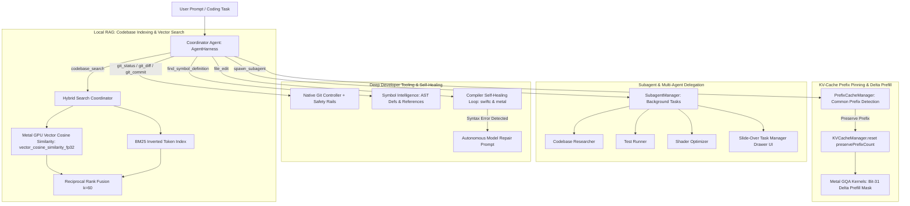

# DynaMoE

*Dynamic, SSD-Streamed Mixture-of-Experts, Hybrid Attention, JetSpec Speculative Tree Acceleration, Native Autonomous Coding Agent, and Local OpenAI/Anthropic-Compatible Inference Server on Apple Silicon.*

DynaMoE is a high-performance native macOS application, a local inference engine, an autonomous developer assistant, and a local inference server that other tools on your Mac can talk to over OpenAI- and Anthropic-compatible APIs.

Engineered specifically for Apple Silicon's Unified Memory Architecture (UMA), DynaMoE runs massive Mixture-of-Experts (MoE) and cutting-edge hybrid attention architectures that exceed physical system RAM by dynamically memory-mapping and streaming weights directly from high-speed NVMe storage to the GPU. It also runs dense language models.

---

## Inspiration & Acknowledgements

This project was undertaken purely for the joy of exploration by someone who is not a software engineer. Just someone who is enjoying learning with the help of AI.

The following AI models have been used to code DynaMoE:
* Gemini 3.6 Thinking, 3.7 Flash and 3.8 Flash
* Ling 3.0 Flash Fin Free (Opencode)
* GLM 5.3
* GLM 5.3 Flash
* Big Pickle (Opencode)
* Deepseek V4.1 Flash
* Kimi K3

Special thanks and acknowledgement to the open-source projects, dependencies, and research that inspired this architecture and power it today:
* **JetSpec** (Hao AI Lab / UC San Diego — [arXiv:2606.18394](https://arxiv.org/html/2606.18394v2)): Causal parallel tree drafting and tree-causal attention verification for breakthrough speculative decoding throughput.
* **Flash-MoE** (https://github.com/danveloper/flash-moe) by Dan Woods: Pioneering work on MoE expert repackaging format and contiguous binary layer storage layout (`packed_experts/layer_XX.bin`). DynaMoE builds upon Flash-MoE's expert restructuring concepts to enable high-throughput asynchronous POSIX `pread` file streaming directly into shared Metal GPU buffers.
* **Colibri** (https://github.com/JustVugg/colibri): Pioneering work on high-speed off-disk model execution.
* **Hummingbird** (https://github.com/hummingbird-project/hummingbird): The Swift server framework that backs DynaMoE's local inference server, exposing the loaded model over OpenAI- and Anthropic-compatible APIs.

---

## Supported Architectures & Models

**To date, all development and validation has been done on a 2021 Macbook Pro with an M1 Pro CPU, 16 GB RAM and 512 GB SSD.**

DynaMoE supports sparse Mixture-of-Experts, hybrid recurrent SSM/attention architectures, and dense autoregressive transformers with automatic model topology detection.

**Important Note:** DynaMoE uses custom Metal kernels and shaders to run models efficiently and to take full advantage of Apple's unified memory architecture. **There is no need to use MLX quantizations** in DynaMoE. In fact, in many cases, an MLX version will run slower or not run at all in DynaMoE. It is advisable to run the native (non MLX and non-GGUF) versions of models in DynaMoE.

On macOS 26 or later with Apple Intelligence enabled, Apple's built-in **on-device Foundation Model** is also selectable as a zero-install chat backend (plain chat; agent tools, JetSpec, thinking blocks, and KV-cache prefixing are local-weights features that do not apply). It appears in the chat model picker under **System Models**, and it powers `/compact` manual conversation compaction on any backend: a rolling general summary plus a detailed recap of the most recent work replace the evicted history — leaving a blank slate with just the compaction marker — in every later prompt. The system model is a chat-only backend: the local inference server (below) always serves the locally loaded weights.

**The following models have been tested and should run well in DynaMoE:**

* **google/gemma-4-26B-A4B**
* **ornith-ai/Ornith-1.5-35B-A3B**
* **inclusionAI/Ling-3.0-tiny**
* **Qwen/Qwen3.8-Flash-Next and Qwen/Qwen3.8-Flash-Next-FP8**
* **XHToken/Spark-X2.5-4B** - a note on Spark - it uses an interesting hybrid attention architecture with one full attention layer and three sliding-window attention layers. Prefill takes a LONG time on my M1 Pro Macbook, but it has a native 1 million token context. So if you're willing to run it on some interesting longer horizon tasks during downtime, results can be interesting. Fun small model to play with.
* **XHToken/Spark-X2.6-4B** - the same hybrid attention family as X2.5, with a graded reasoning template. The Thinking dropdown offers **High**, **Low**, and **Off** instead of a plain on/off switch; the choice is stored per conversation and rendered into the system prompt as `reasoning_effort`. Expect the same long prefill on an M1 Pro and the same 1 million token context.

**Note:** I don't currently have enough disk space to fully repack Qwen3.8 Flash Next to test streaming optimizations. If anyone has the room to test speeds with full repacking, please do let me know. I will be able to conduct further tests once I get a new computer :)

---


---

### Key Architectural Strengths:
* **Hybrid Recurrent SSM + Sparse/Full Attention**: GatedDeltaNet linear recurrent attention layers ($O(1)$ constant-memory recurrent state updates) with Sigmoid output gating interleaved 3:1 with Qwen Sparse Attention (QSA) or Grouped-Query Attention (GQA).
* **Massive Fine-Grained Sparsity & High-Throughput Routing**: 256–512 routed experts per layer (Top-8 / Top-10 activated per token) plus dedicated Sigmoid-gated shared experts with zero-copy NVMe streaming.
* **Direct Unpacked Shard Streaming**: Direct POSIX `pread` bulk priming from 100+ HuggingFace `.safetensors` shards at sequential NVMe line rate (>4.1 GB/s) without requiring disk-doubling weight repacking.
* **Strict Working Set RAM Budgeting**: Double-bounded expert cache (`WorkingSetManager`) that evicts stale experts at layer boundaries during prefill and at token boundaries during generation, eliminating RAM spikes.
* **KV-Cache Prefix Pinning & Delta Prefill**: Intelligent token prefix tracking (`PrefixCacheManager`) that preserves cached Key/Value slots across conversation turns, coupled with a custom Metal GQA kernel protocol that skips redundant invariant tokens to deliver $2.0\times - 3.5\times$ TTFT speedups.
* **Headless Turn Engine & Local API Server**: One single-flight `CompletionEngine` owns prompt templating, prefill/decode dispatch, KV and working-set policing, sampling, stop sequences, and tool-call freezing, so the chat UI and the local server drive the same machinery. A Hummingbird-based server speaks OpenAI Chat Completions and Anthropic Messages (streaming and non-streaming), reuses the pinned KV prefix across stateless API turns by replaying each turn's recorded generation, installs a client's own tool schemas into the grammar mask for the duration of its turn, and serializes concurrent requests through an in-process FIFO queue.
* **4-Stream Gated Residuals & N-Gram PLE Support**: 4 parallel structural residual streams with rank-320 bottleneck read/write gates, unit-offset RMSNorms, and zero-copy Layer 2 N-gram Predictive Local Embedding (PLE) row gathering.
* **JetSpec Speculative Tree Acceleration**: Parallel candidate tree drafting with tree-causal attention masking, expert-aware MoE pruning, and speculative KV cache compaction/rollback.
* **Dynamic Architecture Auto-Detection**: Inspects `config.json`, SafeTensors headers, and tensor topologies to automatically configure layer count, hidden dimensions, attention heads, KV heads, RoPE theta, RMSNorm eps, unit offsets, and MLP projection types.
* **Autonomous Developer Agent & Multi-Agent Swarm**: In-app local RAG vector search, subagent task delegation, native Git safety rails, cross-language AST symbol intelligence, and a compiler self-healing feedback loop.

---

## 🚀 JetSpec Speculative Tree Acceleration

Speculative decoding traditionally forces a trade-off between the latency of sequential drafting (e.g. EAGLE) and the lower acceptance rates of independent block scoring (e.g. DFlash). **JetSpec** solves this by drafting an entire structured candidate tree in a single pass and verifying the tree nodes all at once using **tree-causal attention masking**.

```text
                         ┌─────────────────────────────┐
                         │   Root Token (Node 0)       │
                         └──────────────┬──────────────┘
                                        │
                       ┌────────────────┴────────────────┐
                       ▼                                 ▼
         ┌───────────────────────────┐     ┌───────────────────────────┐
         │ Candidate Branch A (Node 1│     │ Candidate Branch B (Node 2│
         └─────────────┬─────────────┘     └─────────────┬─────────────┘
                       │                                 │
                 ┌─────┴─────┐                     ┌─────┴─────┐
                 ▼           ▼                     ▼           ▼
             [Node 3]    [Node 4]              [Node 5]    [Node 6]
```

### Apple Silicon Unified Memory (UMA) Advantages
On Apple Silicon, JetSpec operates with zero host-to-device memory copy overhead. Candidate tree topology masks, parent-index tables, and multi-layer hidden states are updated directly in unified RAM and immediately accessible to Metal compute kernels.

### MoE Expert Expansion & Dynamic Pruning
When verifying $N$ candidate tree nodes simultaneously on an MoE model, each candidate node routes independently to its top-$K$ experts. The union of active experts $\mathcal{E}_l = \bigcup_{i \in \mathcal{T}} \text{TopK}(W_g \cdot h_{i,l})$ expands with tree width. DynaMoE incorporates an **expert-aware tree pruning engine** that prunes low-confidence branches when $|\mathcal{E}_l|$ exceeds the configured NVMe read bandwidth threshold ($E_{\text{max}}$), guaranteeing optimal speedups even during offloaded SSD streaming.

---

## 🛠️ Autonomous Developer Agent & Native Tooling Ecosystem

DynaMoE includes a full native developer agent harness operating directly within macOS and Apple Silicon Metal:



### 1. Semantic Codebase Indexing & Metal Vector Search (Local RAG)
* **Zero-Dependency Vector Search**: Computes 512-dimensional Apple `NaturalLanguage` sentence embeddings directly on background threads (`Task.detached`), entirely off the main UI thread.
* **Apple Silicon Metal GPU Cosine Kernel**: Executes a high-performance Metal shader (`vector_cosine_similarity_fp32`) that parallelizes dot products across the entire indexed codebase corpus in unified memory.
* **Hybrid Search with Reciprocal Rank Fusion (RRF)**: Combines dense vector similarity with an Okapi BM25 inverted keyword index ($k=60$) to locate both semantic concepts and exact symbol names.
* **Non-Blocking Background Indexing & Watcher**: Uses `DispatchSourceFileSystemObject` for debounced on-save incremental re-indexing, with strict system root guards refusing to scan macOS root paths (`/`, `/System`, `/Library`, `/usr`).

### 2. Subagent & Multi-Agent Delegation Harness (`spawn_subagent`)
* **Isolated Context Windows**: Decomposes large programming tasks into independent child agents with specialized roles (`Codebase Researcher`, `Test Runner`, `Shader Optimizer`, and `Custom Agent`), preventing token budget exhaustion in the coordinator chat.
* **Real Tool-Grounded Pipelines**: Subagent pipelines execute genuine harness tools (`file_read`, `find_files`, `codebase_search`, `shell_run`, `web_search`) scoped to their `allowed_tools` whitelist — every report finding traces back to real tool output recorded in the step transcript, and mid-run coordinator directives (`send_subagent_message`) are consumed between steps (file paths read, commands executed) and folded into the final report.
* **Thread-Safe Orchestration**: `SubagentManager` provides thread-safe agent tracking, inter-agent messaging (`send_subagent_message`), blocking status polling (`get_subagent_status` with `wait`/`timeout_seconds`), and registry listing (`list_subagents`).
* **Coordinator Result-Delivery Contract**: The coordinator system prompt and per-tool directives enforce that the main agent — not the user — retrieves subagent reports (`[SUBAGENT_RESULT]` auto-relay) and presents them in its final answer, even when a background subagent outlives the model's tool-calling turn.
* **Slide-Over Task Drawer UI**: Accessible via the header bar `Tasks` button, featuring live badge counters, duration timers, active status pills, and collapsible step transcripts.

### 3. Deep Developer Tooling, Native Git & Self-Healing Loop
* **Native In-Process Git Engine**: Direct `Process`-level Git integration supporting `git_status`, `git_diff`, and `git_commit` without external dependencies.
* **Strict Safety Rails**: Blocks empty commit messages, detects unstaged file states, and strictly rejects dangerous command flags (`--amend`, `--force`, `-f`, `--hard`, `--no-verify`).
* **Cross-Language Symbol Intelligence**: Fast AST analysis engine locating type/function definitions and call sites across Swift, Metal (`kernel`, `vertex`, `fragment`), Rust, Python, and C/C++.
* **Compiler Self-Healing Diagnostics Loop**: Upon every file edit, `LintDiagnosticsEngine` executes background compiler checks (`swiftc -parse` for Swift and `metal -fsyntax-only` for Metal shaders). When syntax errors are introduced, it captures compiler stderr line/column locations and automatically feeds diagnostic hints back to the model for autonomous repair.

### 4. KV-Cache Prefix Pinning & Live Model Dogfooding
* **Prompt Prefix Cache (`PrefixCacheManager`)**: Detects invariant token prefixes across conversational turns and prevents redundant re-computation.
* **Metal Delta Prefill Protocol**: In `ComputeShaders.metal`, all 6 GQA decode/prefill kernels use bit-31 encoding (`0x80000000 | startPos`) to allow causal attention to attend over preserved prefix slots while computing only delta tokens, slashing Time-to-First-Token (TTFT) by $2.0\times - 3.5\times$.
* **Automated Multi-Turn Stress Test Runner (`ModelDogfoodBenchmarkRunner`)**: Executes an automated 3-turn dogfooding benchmark against real loaded weights in an isolated test repo (`/tmp/dynamoe_dogfood_test_repo`), verifying developer tooling, prefix cache hits, Turbo Mode zero-latency execution, and compiler self-healing.

### 5. External Tool Servers over MCP
* **Model Context Protocol Client**: Connects to MCP servers declared in `~/Library/Application Support/DynaMoE/mcp.json`, over **stdio** (local child processes) or **Streamable HTTP** (remote endpoints). Each server's tools become first-class agent tools, so adding a capability needs no new Swift code.
* **Config File as the Source of Truth**: The JSON file can be hand-edited, version-controlled, or pasted from another client. Settings renders it as a form *and* a raw JSON editor, a directory watcher picks up external edits without a restart, and both the `command`/`args`/`env` and `url`/`headers` shapes are understood.
* **Lazy Tool Exposure**: Discovered tools register as `mcp__<server>__<tool>` in the tool catalog but are **not** loaded into the prompt. The model finds them with `tools_discover` (category `mcp`) and loads them on demand, so an MCP integration costs zero prefill tokens until it is used.
* **Credentials Stay Out of the File**: Secret environment values and headers live in the login Keychain; `mcp.json` holds only a `${keychain:...}` reference. `${env:NAME}` and `${workspace}` expansion happens at connect time and is never written back to disk.
* **Gated by Default**: Every MCP tool call asks for human approval unless Turbo Mode is on, because a remote server can do anything and its own `readOnlyHint` annotation is a claim rather than a guarantee.

---

## Key Highlights & Capabilities

* **Zero-Copy Apple Silicon Unified Memory Bridge:** Memory-maps multi-gigabyte SafeTensors weight shards via `memmap2` in Rust and wraps raw memory addresses directly into Metal GPU buffers (`MTLBuffer(bytesNoCopy:length:options:deallocator:)` with `.storageModeShared`), eliminating redundant CPU-to-GPU copies.
* **High-Throughput NVMe Parallel `pread` Bulk Priming Engine:** Dynamically caches read-only file descriptors for all `.safetensors` model shards (e.g. 131 files for Qwen 3.8 Flash Next) and issues multi-threaded contiguous `pread` block transfers (256 KB chunks) alongside kernel readahead advisories (`fcntl(F_RDADVISE)`). Maximizes NVMe throughput at line rate (>2,500 MB/s to >4,100 MB/s), bypassing macOS page-fault traps and dropping cold-expert slice loading times to ~0.45 ms.
* **Layer-Boundary & Token-Boundary Working Set Memory Management:** Enforces strict memory budgets (`lowMemory`, `balanced16GB`, `unrestricted`) across both prompt prefill and token generation. Automatically evicts stale layer experts at layer boundaries during prefill and evicts inactive experts at token boundaries during generation, eliminating RAM spikes (>16 GB) and keeping physical RAM bounded to the chosen target (e.g. 5.5 GB or 11.5 GB).
* **Apple Silicon Unified Memory (UMA) Telemetry & Reporting:** Reports the total RAM attributable to DynaMoE — Darwin's `phys_footprint` (dirty heap, compressed memory, IOKit/GPU, including the FlashMoE pinned backbone) plus the clean zero-copy weight pages held in the macOS Unified Memory Buffer Cache — and breaks the total down in interactive in-app tooltips. Activity Monitor's *Memory* column shows only the footprint, so it omits the multi-GB weight pages; the cache share is reclaimable under memory pressure. The eviction budget deliberately stays on resident size (`mach_task_basic_info.resident_size`), which is the number the working-set trim compares against its target.
* **SIMD-Coalesced Metal Compute Kernels:** Custom Metal Shading Language (MSL) compute shaders featuring SIMD-coalesced memory access and threadgroup shared memory caching for packed 4-bit/8-bit affine matrix-vector operations, FP8 (`E4M3`/`E5M2`) with block scales (MXFP8), SwiGLU expert projections (`gate_proj`, `up_proj`, `down_proj`), dynamic Top-8/Top-10 routing across up to 512 experts, and token embedding lookups.
* **FlashMoE Contiguous Expert Repackaging (Optional):** Inspired by Dan Woods' Flash-MoE project, DynaMoE supports restructuring sparse MoE model layers into contiguous per-layer expert binaries (`packed_experts/layer_XX.bin` + `layout.json`) with an 8-thread background POSIX `pread` I/O pool (`ExpertIOThreadPool`) for dedicated single-file streaming.
* **Quantized FP8 & FP16 KV Cache:** Dynamically configurable KV cache precision (**FP32**, **FP16**, and **FP8 E4M3/E5M2**), reducing attention cache memory footprints by up to 75% and enabling long-context inference (32k+ tokens) on memory-constrained Macs.
* **Universal Reasoning & `<think>` Accordion:** Automatic detection of reasoning/thinking models across Ornith, Qwen 2.5/3.5, DeepSeek-R1, Nanbeige, GLM, and Nemotron with dynamic inspection of `tokenizer_config.json` and `chat_template.jinja`. Renders real-time, collapsible chain-of-thought blocks with duration timers, char counts, and live streaming pace indicators.
* **Selectable Thinking Levels (Spark X2.6):** The chat toolbar's Thinking menu offers **High**, **Low**, and **Off** for level-capable checkpoints. The choice is stored per conversation, rendered into the model's system prompt as `reasoning_effort`, and defaults to High. Models whose template only has the on/off switch keep the plain On/Off menu.
* **Hardware-Vectorized Accelerate Sampling & Penalties:** Apple Accelerate framework integration using `vDSP_maxvi` for zero-overhead greedy sampling, $O(\log K)$ min-heap Top-$K$ candidate tracking, vectorized softmax normalization (`vvexpf`, `vDSP_vsmul`), dynamic **Min-$P$** and **Top-$P$ (Nucleus)** probability truncation, and bounded **Repetition Penalty** and additive **Presence Penalty** to eliminate vocabulary looping without degrading throughput.
* **Model-Specific Profiles ("Coder" & "Assistant"):** Dedicated per-model generation profiles saving tailored sampling parameters (Temperature, Top-P, Min-P, Top-K, Repetition/Presence Penalties, JetSpec toggles, and System Prompts) for coding versus conversational tasks. Persisted across sessions and quickly toggleable via an in-chat selector.
* **Turbo Mode & Action Confirmation:** Configurable safety controls allowing users to inspect and approve sensitive file modifications or activate **Turbo Mode** (`dynamoe_agent_turbo_mode = true`) for uninterrupted autonomous multi-step tool execution.
* **Rich Markdown & Code Rendering Engine:** High-performance, debounced token streaming UI with full GitHub Flavored Markdown support, including tables with column alignment, blockquotes, callout alerts (`[!NOTE]`, `[!TIP]`, `[!IMPORTANT]`, `[!WARNING]`, `[!CAUTION]`), nested lists, and syntax-highlighted code blocks with one-click copy.
* **Hugging Face Local Cache Auto-Discovery:** Automatically scans `~/.cache/huggingface/hub` on launch to discover all downloaded models, snapshots, weight formats, and quantizations. Allows selecting an overall **Default Model** and automatically tracks the **Last Used Model**.
* **Antigravity-Style Multi-Session Chat UI:** Full multi-session chat workspace with persistent session history, creation, renaming, deletion, an interactive model switcher, and a 1-click **Profile Selector** (Coder vs. Assistant) in the chat toolbar.
* **Native macOS View Menu & Zoom Controls:** Top "View" menu options with standard keyboard shortcuts for **Actual Size** (`⌘0`), **Zoom In** (`⌘+`), and **Zoom Out** (`⌘-`) featuring proportional pixel-perfect geometry scaling.
* **In-App Help & Comprehensive Settings Guide:** Native documentation viewer accessible via **Help $\to$ DynaMoE Help & Settings Guide** (`⌘?`), Settings header button, or offline via [`SETTINGS_GUIDE.md`](SETTINGS_GUIDE.md).
* **Local Inference Server (OpenAI- & Anthropic-Compatible):** Serves the loaded model on `127.0.0.1` over `/v1/chat/completions`, `/v1/messages`, `/v1/models` and `/health`, with SSE streaming, tool calling, reasoning, stop sequences, usage accounting, optional API-key auth, an in-process request queue, and KV-prefix reuse across stateless client turns. Details in the **Local Inference Server** section below.

---

## Architecture Overview

```text
DynaMoE/
├── DynaMoE/                 # Native macOS App (SwiftUI, Metal GPU Pipelines, Headless Turn Engine & API Server)
│   ├── DynaMoEApp.swift     # Application entry point, View/Help menu commands, and AppZoomManager
│   ├── ContentView.swift    # Chat workspace coordinator, Metal compute dispatch and UI wiring around the turn engine
│   ├── CompletionEngine.swift # Headless single-flight turn executor: prefill/decode dispatch, prefix pinning, tool freeze
│   ├── CompletionTypes.swift # Turn request, result and event types shared by the UI, the engine and the API server
│   ├── ChatPromptFormatter.swift # Per-family chat templates and multi-turn rendering that keeps the pin reusable
│   ├── EngineRuntime.swift  # Engine-runtime state (KV precision, working-set budgets, prefill pools) moved out of the UI
│   ├── ServerController.swift # Local inference server: routing, auth, SSE writers, FIFO queue and turn lifecycle
│   ├── OpenAIAdapter.swift  # OpenAI Chat Completions wire types, prompt assembly and response mapping
│   ├── AnthropicAdapter.swift # Anthropic Messages wire types, thinking blocks, tool_use turns and response mapping
│   ├── GrammarConstrainedSampler.swift # Token-level grammar mask: tool-call markup and per-turn client tool schemas
│   ├── NativeToolRegistry.swift # Shell, file and search tool implementations plus the curated child-process environment
│   ├── ChatDetailView.swift # Antigravity-style chat interface, markdown parser, thinking accordion, model/profile switcher
│   ├── ChatModels.swift     # Multi-session chat models and message state
│   ├── ChatSessionStore.swift # Versioned per-conversation JSON persistence, debounced writes and retention pruning
│   ├── ChatCommand.swift    # Slash commands (compaction and friends) available from the chat composer
│   ├── AgentHarness.swift   # Autonomous tool calling coordinator, execution pipeline & safety rails
│   ├── CodebaseIndexer.swift # Background AST document chunker, NL sentence embedder & BM25 inverted index
│   ├── VectorSearchEngine.swift # Metal GPU cosine similarity kernel dispatch (vector_cosine_similarity_fp32)
│   ├── SubagentManager.swift # Subagent orchestration singleton, lifecycle states & thread-safe registry
│   ├── SubagentDrawerView.swift # Slide-over Task Manager drawer UI for monitoring active subagents
│   ├── DeveloperTooling.swift # Native GitController, SymbolIntelligenceEngine & LintDiagnosticsEngine
│   ├── PrefixCacheManager.swift # Multi-turn prompt prefix cache registry & TTFT speedup tracking
│   ├── ModelDogfoodBenchmarking.swift # End-to-end 3-turn dogfooding benchmark runner & isolated repo tester
│   ├── StreamingToolParser.swift # Universal tool invocation parser (Antigravity XML, Markdown, JSON blocks)
│   ├── ToolExecutionTimelineView.swift # Collapsible execution cards for tool calls, diffs & status badges
│   ├── ActionConfirmationView.swift # Security confirmation modal for file modifications and Turbo Mode toggle
│   ├── LocalModelManager.swift # Hugging Face cache scanner (~/.cache/huggingface/hub) and model registry
│   ├── ModelConfig.swift    # Config parser, architecture detection, and system prompt conjunction resolver
│   ├── ModelProfileManager.swift # Model-specific generation profiles (Coder & Assistant) and persistence
│   ├── ExpertRepacker.swift # Flash-MoE layer packing utility (packed_experts/layer_XX.bin)
│   ├── ExpertIOThreadPool.swift # Dedicated background POSIX pread worker pool for packed layers
│   ├── SettingsSheetView.swift # Comprehensive Settings: Models, Profiles, Server, JetSpec Controls, Dogfooding, Memory Modes
│   ├── SettingsComponents.swift # Reusable settings card, row, badge and status components
│   ├── SettingsWindowManager.swift # Independent window management for Settings
│   ├── HelpAndSettingsGuideView.swift # In-app searchable Help & Settings Guide (⌘?)
│   ├── AboutDynaMoEView.swift # Rich About DynaMoE modal
│   ├── SidebarView.swift    # Navigation sidebar for chat sessions, model info, and working set RAM telemetry
│   ├── InferenceEngine.swift # GPU pipeline abstractions and compute shaders bridge
│   └── ComputeShaders.metal # MSL Kernels (Q4/Q8 GEMV, SIMD SwiGLU, MXFP8, DeltaNet, GQA, Vector Cosine, Tree Verification)
├── GeneratedFFI/            # Auto-Generated Swift UniFFI Bindings
│   ├── dynamoe_core.swift   # High-level Swift wrapper around Rust engine
│   └── dynamoe_coreFFI.*    # C headers & module maps
├── core/                    # High-Performance Rust Compute Core (`dynamoe-core`)
│   ├── Cargo.toml           # Engine dependencies (memmap2, safetensors, uniffi, tokenizers)
│   ├── src/lib.rs           # Multi-shard mmap engine, index parser, tensor catalog, generalized 3D slicing
│   ├── src/jetspec.rs       # JetSpec candidate tree topology, causal masks, MoE pruner, acceptance oracles
│   └── src/bin/uniffi-bindgen.rs # Bindgen entry point invoked by the app's build phase
├── DynaMoE/DynaMoETests/    # XCTest suites: pure-logic coverage plus model-bound dogfooding tests
├── Benchmarks/              # Headless decode benchmark (dynamoe_stream_bench) and the PERF_FINDINGS journal
├── Tools/                   # Sparkle release, appcast and preflight scripts
├── SETTINGS_GUIDE.md        # Complete Settings documentation & hardware tuning guide
└── README.md
```

---

## Project Status - Check Issues to see what's in the hopper

- [x] Add auto-update capability (Sparkle)
- [x] MoE streaming bottleneck resolution (speed increase of over 500% compared to previous streaming speed)
- [x] Support Apple Foundation Models
- [x] Use Apple Foundation Model (AFM) to compact conversations
- [x] Serve the loaded model over OpenAI- and Anthropic-compatible APIs, with streaming, tool calling, reasoning, and prefix reuse across stateless turns
- [ ] Configurable YaRN RoPE scaling UI toggle for long-context execution up to 1M tokens.
- [ ] UI/UX refinement

---

## Getting Started

If you're interested in building and running the app in your own development environment:

### Prerequisites
* macOS 15.6+ (macOS 26 or later to use the on-device Apple system model and `/compact` conversation compaction)
* Apple Silicon Mac (M1/M2/M3/M4/M5/M6, 16 GB+ Unified Memory recommended)
* Xcode 26 or later with Command Line Tools (the project builds in Swift 5 language mode with default `MainActor` actor isolation)
* Rust toolchain (`curl --proto '=https' --tlsv1.2 -sSf https://sh.rustup.rs | sh`)

### Building and Running
1. Clone the repository:
   ```bash
   git clone https://github.com/derekrparris/DynaMoE.git
   cd DynaMoE
   ```
2. Open `DynaMoE/DynaMoE.xcodeproj` in Xcode.
3. Press **Cmd + R** to build and launch DynaMoE. The app target has a build phase that compiles the Rust core with `cargo` and regenerates the UniFFI Swift bindings into `GeneratedFFI/` on every build, so there is no separate setup step. To do it by hand, the core is a static library:
   ```bash
   cd core
   cargo build --release
   cargo run --bin uniffi-bindgen generate --library target/release/libdynamoe_core.a --language swift --no-format --out-dir ../GeneratedFFI
   cd ..
   ```
   The `--no-format` flag matters: newer `uniffi-bindgen` releases otherwise shell out to `xcrun swift-format`, which can hang the build.
4. On startup, DynaMoE automatically scans your `~/.cache/huggingface/hub` directory for downloaded models. Open **Settings (⌘,) $\to$ Models** to select your default model, or select any discovered model directly from the chat dropdown!
5. For detailed explanations of every setting, sampling formulas, and hardware presets, consult the [**DynaMoE Settings & User Guide**](SETTINGS_GUIDE.md) or open it directly in the app via **Help $\to$ DynaMoE Help & Settings Guide** (`⌘?`).

If you want to help test beta releases of the app, check the releases section. use the in-app documentation for guidance on using the various settings.

Additional things to be aware of: 

Ling 3.0 Tiny does not support FP8 quantization. So if you choose that option in settings, know that DynaMoE will automatically fall back to FP16.

If a build fails with `error: cannot execute tool 'metal' due to missing Metal Toolchain`, the Metal toolchain is a separately downloaded component on recent Xcode versions: run `xcodebuild -downloadComponent MetalToolchain`.

The Xcode targets always link `core/target/debug/libdynamoe_core.a`; the Release build phase copies the release archive over that path so both configurations work through the same reference. Don't remove that copy step.

---

## 🌐 Local Inference Server (OpenAI- & Anthropic-compatible APIs)

DynaMoE can serve the model currently loaded in the app as a local inference server on `127.0.0.1` — no external service, no egress. Enable it in **Settings (⌘,) → Server** (it then auto-starts on every launch), or watch live status, queue depth, request counters and the last error in the same tab.

The server drives the same headless turn engine as the chat UI, so a client gets what the app would have generated: the same per-family chat templates, samplers, KV-cache prefix reuse, grammar-constrained tool calls, reasoning splitting and stop-sequence handling. Two consequences worth knowing up front: only locally loaded weights are servable (the on-device Apple system model is a separate, chat-only backend), and the API shares the engine's single turn slot with the app, so a request that arrives while an in-app response is generating is answered with `503` once it reaches the front of the queue.

### Endpoints

| Endpoint | Protocol | Notes |
| --- | --- | --- |
| `POST /v1/chat/completions` | OpenAI Chat Completions | Streaming (SSE) + non-streaming; `reasoning_content` deltas for thinking models, `tool_calls` in responses, `tools` / `tool_choice` (`auto`, `none`), `reasoning_effort` (`low`, `high`) for level-capable models, sampler extras (`top_k`, `min_p`, `repetition_penalty`, `presence_penalty`) |
| `POST /v1/messages` | Anthropic Messages | Streaming + non-streaming; `thinking` blocks (`budget_tokens` maps to low/high for level-capable models), `tool_use` / `tool_result` turns, `max_tokens` required, `stop_reason` reports `stop_sequence` and `tool_use` |
| `GET /v1/models` | OpenAI model list | Lists the model loaded in the app |
| `GET /health` | Liveness/readiness | `status`, `model_loaded`, `model`, `engine_active` |

### Server behavior

* **One turn at a time, in arrival order**: the engine is single-flight, so concurrent requests are queued; queued streaming clients receive SSE heartbeats so they never idle-timeout while waiting, and each request's own queue deadline is enforced (see the tuning keys below).
* **Prefix reuse across stateless API turns**: an API client resends the whole conversation every turn, so the server keeps its own record of the last completed turn (raw generation, reasoning included) and replays it whenever the echoed history matches. A follow-up then extends the pinned prompt+generation instead of re-prefilling the conversation, which is the same `2.0x - 3.5x` TTFT win the chat UI gets. Because the record is server-side, a client that resends only the visible answer still reproduces the pin; a client that also echoes reasoning back (`reasoning_content`, or Anthropic thinking blocks) reproduces it even when the server has no record left. Reuse is refused whenever the history, the rendered system prompt or the echoed answer no longer match, so one conversation's turn is never spliced into another's prompt, and a rejected or timed-out request leaves the live pin's temporal context intact.
* **Tool calling**: the tool schemas a client sends are installed into the grammar mask for the duration of that turn, so a masked sample can never rewrite the client's own tool name into a built-in one. Calls come back as `tool_calls` (OpenAI) or `tool_use` blocks (Anthropic); send the result back as a `tool` / `tool_result` turn to continue the loop.
* **Reasoning**: opt out per request with `"enable_thinking": false` (OpenAI) or opt in with `"thinking": {"type": "enabled"}` (Anthropic). On level-capable checkpoints (Spark X2.6), select the graded level with `"reasoning_effort": "low" | "high"` (OpenAI) or `thinking.budget_tokens` (Anthropic: below 4096 selects low, otherwise high). Unsupported levels and models without graded levels are rejected with `400` instead of silently ignoring the request. Reasoning arrives out of band as `reasoning_content` deltas or thinking blocks, or folded into `content` inside the model's own reasoning tags when inline reasoning mode is enabled.
* **Stop sequences**: matched incrementally as tokens decode. A trailing suffix that could still complete a configured stop sequence is withheld from the stream (and a repaired snapshot never re-sends text a client cannot un-see), so clients never receive half a stop string.
* **Cancellation**: stopping or restarting the server cancels only the turns the server owns; an in-progress in-app response is left alone.
* **Explicit rejections**: unsupported request shapes are refused with `400` where the client can see them instead of being silently ignored — a forced tool choice the engine cannot enforce, and an Anthropic request that ends with an assistant message carrying text (a response prefill the server cannot report back as an Anthropic message).

### Authentication

Set an API key in **Settings → Server**. When set, clients must present it either as `Authorization: Bearer <key>` (OpenAI convention) or the `x-api-key: <key>` header (Anthropic convention). Empty key = open access to local processes; the server binds only to `127.0.0.1`, so nothing outside your Mac can connect.

### Client setup (e.g. Crush)

Point any OpenAI-compatible client at base URL `http://127.0.0.1:8787/v1`, or any Anthropic client at `http://127.0.0.1:8787`. The `model` field is accepted but ignored — the model loaded in the app answers every request. Streaming, stop sequences, tool/function calling, reasoning and usage accounting all work out of the box. Anthropic requests must send `max_tokens`; an OpenAI request that omits it uses the app's Generation setting. Watch the Server tab while a client is connected: it shows the bound port, queue depth, active and total request counters, and the last engine error, which is the fastest way to tell a client-side misconfiguration from a queued-then-503 turn.

### Request logging

Every turn is recorded — API requests and in-app chat/agent turns alike — so you can answer "what did the server actually run?" after the fact without switching on debug flags. The Request Log card in **Settings → Server** shows the live list, and the same rows land in Console.app.

* **Metadata always.** Each row carries the method (a `TURN` for in-app turns), path (`chat` / `agent`, or the API route), `source` (`httpAPI` vs `chatUI`), wire status, streaming termination, model, input/output token counts, total duration, queue wait split from generation time, first-token latency, finish reason, tool names and the error message. The queue wait is stamped the instant the engine's single-flight slot opens, and stays `nil` rather than `0` for a turn that never ran (queue timeout, cancelled while queued), so "no wait" and "never ran" stay distinguishable.
* **Bodies are opt-in.** Turn on **Store Request Content** (`dynamoe_server_log_store_bodies`) to persist prompts and responses as well, clipped to 32 KB per field. API rows store the normalized client request; in-app rows store the rendered prompt the model actually saw (template included) plus the turn's reasoning and answer. Tool arguments (4 KB cap) follow the same toggle. With capture off, every body field records an explicit `[content withheld — metadata only]` marker, so "withheld" never reads as silence.
* **Nothing sensitive leaves the machine.** Authorization headers and the configured API key never reach a row or a unified-log line. Wire errors that reflect client-supplied values (an invalid message `role`, a rejected tool choice, a tokenizer failure quoting prompt text) keep those values on the wire for the client but record a value-free rendering, so a persisted or logged error cannot smuggle request content.
* **Where it lives.** An append-only SQLite database at `~/Library/Application Support/DynaMoE/logs/server-requests.sqlite` (raw SQLite C API; writes are fire-and-forget on a private serial queue). Retention is 30 days / 20,000 rows, and clearing or mass-pruning compacts the file so the disk space is actually reclaimed. `GET /health` is never logged — health polling would otherwise flood the store.
* **Dashboard and export.** The Request Log card offers full-text search (matched against the persisted JSON, so what you type is what you find), an Errors Only switch, a per-row detail sheet, and **Export** to JSON Lines honoring the current filter. The list refreshes from the store's own change stream, so new rows appear without polling.
* **Console.app.** Every row also emits a metadata-only line under subsystem `DRP.DynaMoE`, category `server.request`. Each line leads with `id=<shortId>`, the lowercase 8-hex prefix of the row id — paste that short id into the dashboard search to jump straight from a Console line to its row.

### Guardrails & tuning keys (UserDefaults)

The Server tab writes the enable toggle, port, API key, inline reasoning and content-capture keys; the queue timeout and prompt ceiling are set with the `defaults` command (the app reads them at request time, so no restart is needed).

| Key | Default | Meaning |
| --- | --- | --- |
| `dynamoe_server_enabled` | `false` | Auto-start the server at launch (the settings toggle writes this) |
| `dynamoe_server_port` | `8787` | Listen port (changes require a restart) |
| `dynamoe_server_api_key` | *(empty)* | Required bearer / x-api-key value |
| `dynamoe_server_queue_timeout` | `120` seconds | Requests waiting longer in the queue are rejected (408 / SSE error). `0` disables |
| `dynamoe_server_max_prompt_tokens` | `262144` tokens | Longer prompts are rejected with 400 before prefill. `0` disables |
| `dynamoe_agent_session_floor` | `8192` rows | KV rows an agent (tools-enabled) turn reserves for its tool loop, in-app and API alike. The budget still wins: the reserve is capped to what the machine affords, so it can never reject a prompt that fits. `0` keeps 8,192; values above the 32,768-row provision ceiling are clamped to it. Chat turns without tools reserve 2,048 |
| `dynamoe_server_inline_reasoning` | `false` | OpenAI endpoint only: fold reasoning into `content` inside the model's reasoning tags instead of reporting it as `reasoning_content`, so clients that ignore that extension still display it (and echo it back) |
| `dynamoe_server_log_store_bodies` | `false` | Persist request/response bodies (and tool arguments) in the request log, for API and in-app rows alike. Off keeps rows metadata-only (the Settings → Server "Store Request Content" toggle writes this) |

For example, to allow an unlimited queue wait and a 512k prompt ceiling:

```bash
defaults write DRP.DynaMoE dynamoe_server_queue_timeout -int 0
defaults write DRP.DynaMoE dynamoe_server_max_prompt_tokens -int 524288
```

A `400` carrying `"code": "context_length_exceeded"` means the machine's KV budget (RAM minus the model footprint minus 2.5 GB of working reserve) could not provision the prompt plus usable generation at the configured KV precision. The message names the budget, the model footprint, the precision and the rows it affords; `dynamoe_agent_session_floor` lowers the agent reserve, and FP8 KV plus a smaller model footprint raise the ceiling.

---

## License

Distributed under the Apache License, Version 2.0. See [`LICENSE`](LICENSE) and [`THIRD_PARTY_LICENSES.md`](THIRD_PARTY_LICENSES.md) for details.

