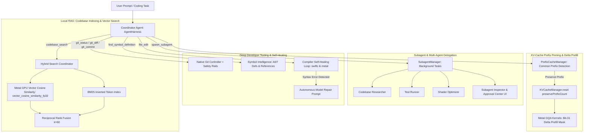

# DynaMoE

*Dynamic, SSD-Streamed Mixture-of-Experts, Hybrid Attention, JetSpec Speculative Tree Acceleration, Native Autonomous Coding Agent, and Local OpenAI/Anthropic-Compatible Inference Server on Apple Silicon.*

DynaMoE is a high-performance native macOS application, a local inference engine, an autonomous developer assistant, and a local inference server that other tools on your Mac can talk to over OpenAI- and Anthropic-compatible APIs.

Engineered specifically for Apple Silicon's Unified Memory Architecture (UMA), DynaMoE runs massive Mixture-of-Experts (MoE) and cutting-edge hybrid attention architectures that exceed physical system RAM by dynamically memory-mapping and streaming weights directly from high-speed NVMe storage to the GPU. It also runs dense language models.

---
**Make sure to check the latest release to see what's new with DynaMoE!**  
I'm not great at keeping this readme up to date on all the latest and greatest changes! :)

---

## Inspiration & Acknowledgements

This project was undertaken purely for the joy of exploration by someone who is not a software engineer. Just someone who is enjoying learning with the help of AI.

The following AI models have been used to code DynaMoE:
* Gemini 3.6 Thinking, 3.7 Flash and 3.8 Flash
* Ling 3.0 Flash Fin Free (Opencode)
* GLM 5.3
* GLM 5.3 Flash
* Big Pickle (Opencode)
* Deepseek V4.1 Flash
* Kimi K3

Special thanks and acknowledgement to the open-source projects, dependencies, and research that inspired this architecture and power it today:
* **JetSpec** (Hao AI Lab / UC San Diego — [arXiv:2606.18394](https://arxiv.org/html/2606.18394v2)): Causal parallel tree drafting and tree-causal attention verification for breakthrough speculative decoding throughput.
* **Flash-MoE** (https://github.com/danveloper/flash-moe) by Dan Woods: Pioneering work on MoE expert repackaging format and contiguous binary layer storage layout (`packed_experts/layer_XX.bin`). DynaMoE builds upon Flash-MoE's expert restructuring concepts to enable high-throughput asynchronous POSIX `pread` file streaming directly into shared Metal GPU buffers.
* **Colibri** (https://github.com/JustVugg/colibri): Pioneering work on high-speed off-disk model execution.
* **Hummingbird** (https://github.com/hummingbird-project/hummingbird): The Swift server framework that backs DynaMoE's local inference server, exposing the loaded model over OpenAI- and Anthropic-compatible APIs.

---

## Supported Architectures & Models

**Development started on a 2021 MacBook Pro with an M1 Pro CPU, 16 GB RAM and a 512 GB SSD; the long-context and streaming numbers in this README were measured on an M5 Max with 128 GB, and the memory presets are still tuned for the M1 Pro.**

DynaMoE supports sparse Mixture-of-Experts, hybrid recurrent SSM/attention architectures, dense autoregressive transformers, and looped/recurrent-depth transformers with automatic architecture detection from the checkpoint's own config and tensor shapes.

**Important Note:** DynaMoE uses custom Metal kernels and shaders to run models efficiently and to take full advantage of Apple's unified memory architecture. **There is no need to use MLX quantizations** in DynaMoE. In fact, in many cases, an MLX version will run slower or not run at all in DynaMoE. It is advisable to run the native (non-MLX and non-GGUF) versions of models in DynaMoE.

On macOS 26 or later with Apple Intelligence enabled, Apple's built-in **on-device Foundation Model** is also selectable as a zero-install chat backend (plain chat; agent tools, JetSpec, thinking blocks, and KV-cache prefixing are local-weights features that do not apply). It appears in the chat model picker under **System Models**, and it summarizes `/compact` manual conversation compaction for local conversations; a cloud conversation is summarized by the provider model already answering it, so that command needs no Apple Intelligence. Either way a rolling general summary plus a detailed recap of the most recent work replace the evicted history, stay visible in an expandable summary card at the top of the chat, and ride into every later prompt. Cloud turns also compact automatically as they approach the model's recorded context window. The system model is a chat-only backend: the local inference server (below) always serves the locally loaded weights.

**The following models have been tested and should run well in DynaMoE:**

* **deepseek-ai/DeepSeek-V4.1-Flash-1017** - a ~475 GB, 48-shard sparse MoE with compressed attention, Engram n-gram memory, a vision tower and a draft block, served by its own runtime. See [DeepSeek-V4.1-Flash](#deepseek-v41-flash) below.
* **Nanbeige/Nanbeige4.3-33B** - a 33B dense `LlamaForCausalLM` (66 GB BF16, 52 layers of 7168 hidden, 56/8 query/key-value heads, native 524,288-token context) tuned for agentic tool use. It needs a large-Unified-Memory Mac to hold in Full RAM; on a smaller machine raise the KV cache to FP8 before driving it past ~100k tokens. Its **Quantize to Q4 / Q8** action (Models → ⋯) rewrites the weights into one contiguous quantized blob next to the snapshot: 66 GB becomes ~34 GB at Q8 and ~22 GB at Q4, which is what decode throughput tracks, and a Q4 repack of the published checkpoint still answers its published turn, with the same opening tokens as the full-precision run. DynaMoE renders its own chat template (`<|im_start|>` framing, a ` thinking` channel, `<tool_response>` tool turns) and its `qwen3_coder` XML tool calls. Its checkpoint declares `model_type: llama`, so the app identifies it from the checkpoint's shape (a 166,912-row vocabulary) rather than from its name.
* **thinkingmachines/Inkling-2-Mini** - a 24-layer decoder executed as a fixed 48-visit loop with relative-position attention, block attention residuals and mixed NVFP4/MXFP8 experts (~20 GB on disk, 128 experts top-8, 1M architectural context). See [Inkling 2 Mini](#inkling-2-mini) below.
* **google/gemma-4-26B-A4B**
* **ornith-ai/Ornith-1.5-35B-A3B**
* **inclusionAI/Ling-3.0-tiny**
* **Qwen/Qwen3.8-Flash-Next and Qwen/Qwen3.8-Flash-Next-FP8**
* **XHToken/Spark-X2.5-4B** - a note on Spark - it uses an interesting hybrid attention architecture with one full attention layer and three sliding-window attention layers. Prefill takes a LONG time on my M1 Pro MacBook, but it has a native 1 million token context. So if you're willing to run it on some interesting longer horizon tasks during downtime, results can be interesting. Fun small model to play with.
* **XHToken/Spark-X2.6-4B** - the same hybrid attention family as X2.5, with a graded reasoning template. The Thinking dropdown offers **High**, **Low**, and **Off** instead of a plain on/off switch; the choice is stored per conversation and rendered into the system prompt as `reasoning_effort`. Expect the same long prefill on an M1 Pro and the same 1 million token context.

**Note:** I don't currently have enough disk space to fully repack Qwen3.8 Flash Next to test streaming optimizations. If anyone has the room to test speeds with full repacking, please do let me know. I will be able to conduct further tests once I get a new computer :)

---


---

### Key Architectural Strengths:
* **Hybrid Recurrent SSM + Sparse/Full Attention**: GatedDeltaNet linear recurrent attention layers ($O(1)$ constant-memory recurrent state updates) with Sigmoid output gating interleaved 3:1 with full attention -- Qwen Sparse Attention (QSA) on Qwen 3.8 Flash Next, Grouped-Query Attention (GQA) elsewhere.
* **Massive Fine-Grained Sparsity & High-Throughput Routing**: 256–512 routed experts per layer (Top-8 / Top-10 activated per token) plus dedicated Sigmoid-gated shared experts with zero-copy NVMe streaming.
* **Direct Unpacked Shard Streaming**: Direct POSIX `pread` bulk priming from 100+ HuggingFace `.safetensors` shards at sequential NVMe line rate (>4.1 GB/s) without requiring disk-doubling weight repacking.
* **Strict Working Set RAM Budgeting**: Double-bounded expert cache (`WorkingSetManager`) that evicts stale experts at layer boundaries during prefill and at token boundaries during generation, eliminating RAM spikes.
* **KV-Cache Prefix Pinning & Delta Prefill**: Intelligent token prefix tracking (`PrefixCacheManager`) that preserves cached Key/Value slots across conversation turns, coupled with a custom Metal GQA kernel protocol that skips redundant invariant tokens to deliver $2.0\times - 3.5\times$ TTFT speedups.
* **Headless Turn Engine & Local API Server**: One single-flight `CompletionEngine` owns prompt templating, prefill/decode dispatch, KV and working-set policing, sampling, stop sequences, and tool-call freezing, so the chat UI and the local server drive the same machinery. A Hummingbird-based server speaks OpenAI Chat Completions, the legacy OpenAI Completions endpoint and Anthropic Messages (streaming and non-streaming), reuses the pinned KV prefix across stateless API turns by replaying each turn's recorded generation, installs a client's own tool schemas into the grammar mask for the duration of its turn, and serializes concurrent requests through an in-process FIFO queue.
* **Isolated Family Runtimes**: Architectures the generic decode loop cannot express (DeepSeek V4.1, Inkling 2) get their own runtime directory that `CompletionEngine` dispatches to, leaving the generic prefill/decode/JetSpec graph untouched for every other family.
* **4-Stream Gated Residuals & N-Gram PLE Support**: 4 parallel structural residual streams with a rank-320 bottleneck read/write gate, unit-offset RMSNorms, and zero-copy N-gram Predictive Local Embedding (PLE) row gathering.
* **JetSpec Speculative Tree Acceleration**: Parallel candidate tree drafting with tree-causal attention masking, expert-aware MoE pruning, and speculative KV cache compaction/rollback.
* **Dynamic Architecture Auto-Detection**: Inspects `config.json`, SafeTensors headers, and tensor topologies to automatically configure layer count, hidden dimensions, attention heads, KV heads, RoPE theta, RMSNorm eps, unit offsets, and MLP projection types.
* **Autonomous Developer Agent & Multi-Agent Swarm**: In-app local RAG vector search, subagent task delegation, native Git safety rails, cross-language AST symbol intelligence, and a compiler self-healing feedback loop.

---

## 🚀 JetSpec Speculative Tree Acceleration

Speculative decoding traditionally forces a trade-off between the latency of sequential drafting (e.g. EAGLE) and the lower acceptance rates of independent block scoring (e.g. DFlash). **JetSpec** solves this by drafting an entire structured candidate tree in a single pass and verifying the tree nodes all at once using **tree-causal attention masking**.

```text
                         ┌─────────────────────────────┐
                         │   Root Token (Node 0)       │
                         └──────────────┬──────────────┘
                                        │
                       ┌────────────────┴────────────────┐
                       ▼                                 ▼
         ┌───────────────────────────┐     ┌───────────────────────────┐
         │ Candidate Branch A (Node 1│     │ Candidate Branch B (Node 2│
         └─────────────┬─────────────┘     └─────────────┬─────────────┘
                       │                                 │
                 ┌─────┴─────┐                     ┌─────┴─────┐
                 ▼           ▼                     ▼           ▼
             [Node 3]    [Node 4]              [Node 5]    [Node 6]
```

### Apple Silicon Unified Memory (UMA) Advantages
On Apple Silicon, JetSpec operates with zero host-to-device memory copy overhead. Candidate tree topology masks, parent-index tables, and multi-layer hidden states are updated directly in unified RAM and immediately accessible to Metal compute kernels.

### MoE Expert Expansion & Dynamic Pruning
When verifying $N$ candidate tree nodes simultaneously on an MoE model, each candidate node routes independently to its top-$K$ experts. The union of active experts $\mathcal{E}_l = \bigcup_{i \in \mathcal{T}} \text{TopK}(W_g \cdot h_{i,l})$ expands with tree width. DynaMoE incorporates an **expert-aware tree pruning engine** that prunes low-confidence branches when $|\mathcal{E}_l|$ exceeds the configured NVMe read bandwidth threshold ($E_{\text{max}}$), guaranteeing optimal speedups even during offloaded SSD streaming.

---

## 🧠 Model Families

DynaMoE is data-driven about models: a family is recognised from its own checkpoint (config fields, tensor names, stored dtypes) and gets a runtime only when the generic decode loop cannot express its graph. Two families have one today, and both keep the generic path untouched for every other model.

### DeepSeek-V4.1-Flash

`deepseek-ai/DeepSeek-V4.1-Flash-1017` (48 shards, 96,085 tensors, ~475 GB) is not a bigger version of the other families: it is a different class of graph, and its runtime lives in `DynaMoE/DynaMoE/DeepSeekV41/` (33 files). `CompletionEngine.launchTurn` hands its turns to `DeepSeekV41TurnRunner` and keeps the built runtime between turns, since indexing 96k tensors, opening 50 descriptors and owning the expert arena are all work a follow-up should not repeat.

* **Two halves of the depth.** 40 layers, the first 20 with a compression ratio of 2 and the last 20 at 1: the causal encoder half compresses its K/V into pooled rows and the decoder half attends over them. Attention is latent (a Q/K/V projection down to a small latent, then up), with a learned per-head sink, and sparse selection over the compressed rows (CSA2): an indexer scores every reachable compressed row and keeps the best `index_topk` (512), rather than simply the newest ones. The eight layers that own a compressed index stop the dense half once to read the scores back; the layer between two sources reuses its source's selection.
* **4-stream mHC residuals.** Four residual streams are mixed by a Sinkhorn-normalized matrix (20 iterations) at every sub-layer, with a low-rank projection (rank 320) to and from the mix. This is what "Hyper-Connections" means in the tensor names (`hc_*`).
* **Engram n-gram memory.** Layers 1 and 14 look up n-gram rows from prime-bucketed hash tables (~98 GB of E4M3 values plus a scale companion), streamed one row at a time. The hash is numpy's `default_rng` reproduced bit for bit, because the checkpoint stores the *results* of that generation and not the multipliers; the vocabulary is a compressed token map built from the checkpoint's own tokenizer through the Rust core.
* **MXFP4 routed experts and an FP8 shared expert.** 384 routed experts per layer, 6 active per token, plus one shared expert. The router scores with `sqrtsoftplus`, and its bias selects experts without weighting them.
* **Everything is streamed deliberately.** The routed experts stream through an arena of wired slots fed by `pread`; the dense backbone is pinned into resident buffers at load, because the zero-copy shard mapping is a GPU page fault per 16 KB once the stream evicts those pages (that pin took a turn from 60.7 s prefill + 348 s decode to 1.18 s + 2.19 s on the published checkpoint).

What it supports today:

| Area | State |
| --- | --- |
| Text turns | Full: prefill, decode, stop handling, prefix reuse, cancellation, thinking levels (`Reasoning Effort:` line), tool dialect measured from the weights |
| Images | In-app turns and both API protocols: the vision tower runs as one device pass, the prompt is priced before the cache is provisioned, and an encoded span is cached by content digest |
| KV cache | FP16 today (the checkpoint's design is FP8); the latent cache is cheap, so context is bounded by the machine's RAM budget rather than by KV |
| Speculative verify / DSpark draft block | Not wired: the draft block's parts are built and checked against the host, but a narrow verify measured slower than walking (width two accepts 50-55% and is 0.83-0.89x a walk per position), so there is nothing to ship until acceptance improves |
| Inkling-style tool grammar mask | Deliberately not installed: the mask's marker vocabulary is Qwen's, so the freeze is keyed on the DSML dialect the model actually emits |

Its context is 1,048,576 architectural positions; what you can actually use is what `KVCacheProvisioning` affords on your machine, and a prompt past the server's 262,144-token default cap is refused with `context_length_exceeded`. The engine refuses the family by name when the runtime cannot serve a request (no tower for an image, a prompt the cache cannot hold) rather than running the wrong graph.

### Inkling 2 Mini

`thinkingmachines/Inkling-2-Mini` is a 24-layer decoder executed as a **fixed 48-visit loop** (layers 0-5 once, 6-17 three times, 18-23 once). Its runtime lives in `DynaMoE/DynaMoE/Inkling2/` (12 files), for the same reason DeepSeek's does: the generic loop assumes ordinary GQA, RoPE, one residual topology and per-layer KV, and none of that describes this graph. The weights are shared across loop passes while KV and the four convolution histories are per visit, so the executor state is 48 bundles: eight visits own a growing full-attention cache and forty are bounded chronological rings.

* **No RoPE.** Positions enter through a relative-distance bias bank (extent 1,024) plus a logarithmic query scale on full-attention layers, and every attention carries a learned sink.
* **Block attention residuals** every six physical layers, plus **cross-pass message gates** that move state between loop passes through rank-64 controllers.
* **2,304 hidden, 24 Q / 8 KV heads of 128, 128 routed experts top-8 with no shared expert, 201,024-row padded vocabulary, mixed NVFP4 (layers 0-19) / MXFP8 (20-23) experts**, ~20 GB of weights.

The host graph is complete and runs the published checkpoint. The device graph runs the attention half, the MLP half and whole visits on the GPU, each compared stage by stage against the host; in the app's own turn path the same two-token turn measured **427-489 s on the host against 14.0-14.5 s on the device**. The checkpoint's own template is rendered for prompts and tools, and its call dialect (a model message naming the tool, an invoke marker, then JSON arguments) is parsed and canonicalized into the shared tool block.

What remains before it is finished: the vision tower is not wired into this family's turns (an attached image is refused by name), KV is FP32 host storage with FP8/INT8 planned, DSpark is not started, and the agent continuation is measured open - the first four ids agree with the reference and then drift into repetition, which is BF16 noise amplified over a long chain rather than a dialect bug, and re-measuring it needs the pinned reference environment rebuilt. The NVFP4 and MXFP8 activation quantizers are the two numerical rules still marked unverified in the family's conformance ledger.

---

## 🛠️ Autonomous Developer Agent & Native Tooling Ecosystem

DynaMoE includes a full native developer agent harness operating directly within macOS and Apple Silicon Metal:



### 1. Semantic Codebase Indexing & Metal Vector Search (Local RAG)
* **Zero-Dependency Vector Search**: Computes 512-dimensional Apple `NaturalLanguage` sentence embeddings directly on background threads (`Task.detached`), entirely off the main UI thread.
* **Apple Silicon Metal GPU Cosine Kernel**: Executes a high-performance Metal shader (`vector_cosine_similarity_fp32`) that parallelizes dot products across the entire indexed codebase corpus in unified memory.
* **Hybrid Search with Reciprocal Rank Fusion (RRF)**: Combines dense vector similarity with an Okapi BM25 inverted keyword index ($k=60$) to locate both semantic concepts and exact symbol names.
* **Non-Blocking Background Indexing & Watcher**: Uses `DispatchSourceFileSystemObject` for debounced on-save incremental re-indexing, with strict system root guards refusing to scan macOS root paths (`/`, `/System`, `/Library`, `/usr`).

### 2. Subagent & Multi-Agent Delegation Harness (`spawn_subagent`)
* **Isolated Context Windows**: Decomposes large programming tasks into independent child agents with specialized roles (`Codebase Researcher`, `Test Runner`, `Shader Optimizer`, and `Custom Agent`), preventing token budget exhaustion in the coordinator chat.
* **Real Tool-Grounded Pipelines**: Subagent pipelines execute genuine harness tools (`file_read`, `find_files`, `codebase_search`, `shell_run`, `web_search`) scoped to their `allowed_tools` whitelist - every report finding traces back to real tool output recorded in the step transcript, and mid-run coordinator directives (`send_subagent_message`) are consumed between steps and folded into the final report.
* **Thread-Safe Orchestration**: `SubagentManager` provides thread-safe agent tracking, inter-agent messaging (`send_subagent_message`), blocking status polling (`get_subagent_status` with `wait`/`timeout_seconds`), and registry listing (`list_subagents`), with a scheduler for capacity, priority and cancellation.
* **Coordinator Result-Delivery Contract**: The coordinator system prompt and per-tool directives enforce that the main agent - not the user - retrieves subagent reports (`[SUBAGENT_RESULT]` auto-relay) and presents them in its final answer, even when a background subagent outlives the model's tool-calling turn.
* **Inspector & Approval Center UI**: A dedicated inspector with live badges, duration timers, status pills, collapsible step transcripts, worktree controls and the operator's own Apply Changes control; writer runs can be isolated in a git worktree per run. Full design in [`SUBAGENTS.md`](SUBAGENTS.md).

### 3. Deep Developer Tooling, Native Git & Self-Healing Loop
* **Native In-Process Git Engine**: Direct `Process`-level Git integration supporting `git_status`, `git_diff`, and `git_commit` without external dependencies.
* **Strict Safety Rails**: Blocks empty commit messages, detects unstaged file states, and strictly rejects dangerous command flags (`--amend`, `--force`, `-f`, `--hard`, `--no-verify`).
* **Cross-Language Symbol Intelligence**: Fast AST analysis engine locating type/function definitions and call sites across Swift, Metal (`kernel`, `vertex`, `fragment`), Rust, Python, and C/C++.
* **Compiler Self-Healing Diagnostics Loop**: Upon every file edit, `LintDiagnosticsEngine` executes background compiler checks (`swiftc -parse` for Swift and `metal -fsyntax-only` for Metal shaders). When syntax errors are introduced, it captures compiler stderr line/column locations and automatically feeds diagnostic hints back to the model for autonomous repair.

### 4. KV-Cache Prefix Pinning & Live Model Dogfooding
* **Prompt Prefix Cache (`PrefixCacheManager`)**: Detects invariant token prefixes across conversational turns and prevents redundant re-computation.
* **Metal Delta Prefill Protocol**: In `ComputeShaders.metal`, the GQA decode and prefill kernels (both the standard and fused/head-gated forms, plus Gemma's) use bit-31 encoding (`0x80000000 | startPos`) to allow causal attention to attend over preserved prefix slots while computing only delta tokens, slashing Time-to-First-Token (TTFT) by $2.0\times - 3.5\times$.
* **Automated Multi-Turn Stress Test Runner (`ModelDogfoodBenchmarkRunner`)**: Executes an automated 3-turn dogfooding benchmark against real loaded weights in an isolated test repo (`/tmp/dynamoe_dogfood_test_repo`), verifying developer tooling, prefix cache hits, Turbo Mode zero-latency execution, and compiler self-healing.

### 5. External Tool Servers over MCP
* **Model Context Protocol Client**: Connects to MCP servers declared in `~/Library/Application Support/DynaMoE/mcp.json`, over **stdio** (local child processes) or **Streamable HTTP** (remote endpoints). Each server's tools become first-class agent tools, so adding a capability needs no new Swift code.
* **Config File as the Source of Truth**: The JSON file can be hand-edited, version-controlled, or pasted from another client. Settings renders it as a form *and* a raw JSON editor, a directory watcher picks up external edits without a restart, and both the `command`/`args`/`env` and `url`/`headers` shapes are understood.
* **Lazy Tool Exposure**: Discovered tools register as `mcp__<server>__<tool>` in the tool catalog but are **not** loaded into the prompt. The model finds them with `tools_discover` (category `mcp`) and loads them on demand, so an MCP integration costs zero prefill tokens until it is used.
* **Credentials Stay Out of the File**: Secret environment values and headers live in the Keychain; `mcp.json` holds only a `${keychain:...}` reference. `${env:NAME}` and `${workspace}` expansion happens at connect time and is never written back to disk.
* **No keychain prompts at launch**: a credential is read only when something actually needs it, and "is one stored?" is answered from item attributes, which macOS returns without a dialog. Shipped builds keep their credentials in the data protection keychain, where access is granted by the app's code-signing identity, so a new version never asks for permission again. Credentials written by an older version are copied across once from the **Stored Credentials** card, which appears in Settings on both **Cloud Providers** and **Agent & Tools** while something is still waiting to be imported.
* **Gated by Default**: Every MCP tool call asks for human approval unless Turbo Mode is on, because a remote server can do anything and its own `readOnlyHint` annotation is a claim rather than a guarantee.

### 6. Skills & Decision Models
* **Agent Skills, Loaded on Demand**: A skill is a folder with a `SKILL.md`. The system prompt advertises only its name and a one-line description; the model reads the procedure with the `skill_load` tool (and any `scripts/`, `reference/` or `assets/` files beside it) when the description matches. An unused skill costs a line of prompt instead of its whole body.
* **Shared Folders, Personal Overrides**: Skills are discovered in `~/.agents/skills`, `~/.claude/skills` and `~/Library/Application Support/DynaMoE/skills` (in that order), plus any `extraRoots` in `skills.json`. A later folder wins a name collision, so an installed starter or a project folder overrides a shared copy; a shadowed skill is reported with the path to remove rather than silently dropped.
* **Always-On Rules**: `always: true` renders a "route this kind of work through me" rule into every **agent** prompt - the local agent turn and the cloud function-calling turn, which are the only prompts that also carry `skill_load`. A plain chat with Agent Tools off has no skills section and no loader, so an always-on rule does nothing there; that is deliberate, because a rule the model cannot act on is prompt cost with no capability behind it. This is how a judgment skill like `subq-decisions` becomes the default without editing each model profile's system prompt.
* **SubQ Decisions as a Native Tool**: `subq_decide` calls SubQ's decisions-only `subq-snap-preview` model (`POST /v1/systemone`) for yes/no gates, routing, triage, classification and ordered scoring, returning probabilities and confidence. The key lives in the Keychain (or is reused from a SubQ Cloud Provider), never enters a prompt or a log line, and `SUBQ_API_KEY` is stripped from every process `shell_run` spawns. A call that uploads local images, or that targets a non-SubQ endpoint, is approval-gated, and plaintext HTTP is refused except on loopback.
* **Design Skills Are Shell-Backed, Not Bundled**: a design skill you install yourself (for example the external `impeccable` skill) runs its own tooling (an audit detector, a context loader) through `shell_run` with the same curated PATH and approval rules as any other command.

---

## Key Highlights & Capabilities

* **Zero-Copy Apple Silicon Unified Memory Bridge:** Memory-maps multi-gigabyte SafeTensors weight shards via `memmap2` in Rust and wraps raw memory addresses directly into Metal GPU buffers (`MTLBuffer(bytesNoCopy:length:options:deallocator:)` with `.storageModeShared`), eliminating redundant CPU-to-GPU copies.
* **High-Throughput NVMe Parallel `pread` Bulk Priming Engine:** Dynamically caches read-only file descriptors for all `.safetensors` model shards (e.g. 131 files for Qwen 3.8 Flash Next) and issues multi-threaded contiguous `pread` block transfers (256 KB chunks) alongside kernel readahead advisories (`fcntl(F_RDADVISE)`). Maximizes NVMe throughput at line rate (>2,500 MB/s to >4,100 MB/s), bypassing macOS page-fault traps and dropping cold-expert slice loading times to ~0.45 ms.
* **Layer-Boundary & Token-Boundary Working Set Memory Management:** Enforces strict memory budgets (`lowMemory`, `balanced16GB`, `unrestricted`) across both prompt prefill and token generation. Automatically evicts stale layer experts at layer boundaries during prefill and evicts inactive experts at token boundaries during generation, eliminating RAM spikes (>16 GB) and keeping physical RAM bounded to the chosen target (e.g. 5.5 GB or 11.5 GB).
* **Apple Silicon Unified Memory (UMA) Telemetry & Reporting:** Reports the total RAM attributable to DynaMoE - Darwin's `phys_footprint` (dirty heap, compressed memory, IOKit/GPU, including the FlashMoE pinned backbone) plus the clean zero-copy weight pages held in the macOS Unified Memory Buffer Cache - and breaks the total down in interactive in-app tooltips. Activity Monitor's *Memory* column shows only the footprint, so it omits the multi-GB weight pages; the cache share is reclaimable under memory pressure. The eviction budget deliberately stays on resident size (`mach_task_basic_info.resident_size`), which is the number the working-set trim compares against its target.
* **SIMD-Coalesced Metal Compute Kernels:** Custom Metal Shading Language (MSL) compute shaders featuring SIMD-coalesced memory access and threadgroup shared memory caching for packed 4-bit/8-bit affine matrix-vector operations, FP8 (`E4M3`/`E5M2`) with block scales (MXFP8), SwiGLU expert projections (`gate_proj`, `up_proj`, `down_proj`), dynamic Top-8/Top-10 routing across up to 512 experts, and token embedding lookups.
* **FlashMoE Contiguous Expert Repackaging (Optional):** Inspired by Dan Woods' Flash-MoE project, DynaMoE supports restructuring sparse MoE model layers into contiguous per-layer expert binaries (`packed_experts/layer_XX.bin` + `layout.json`) with an 8-thread background POSIX `pread` I/O pool (`ExpertIOThreadPool`) for dedicated single-file streaming.
* **Flash-MoE-style Dense Repacking (Optional):** For dense checkpoints, **Quantize to Q4 / Q8** rewrites the weights into one contiguous blob beside the snapshot (`dense_weights.bin` + manifest) with MLX affine quantization at group size 64, keeping the embedding and the output head at full precision. Nanbeige 4.3 shrinks from 66 GB to ~34 GB (Q8) or ~22 GB (Q4), and the Q8 path is served by dedicated affine GEMV/SwiGLU/down-projection kernels with batched prefill forms.
* **Quantized FP8 & FP16 KV Cache:** Dynamically configurable KV cache precision (**FP32**, **FP16**, and **FP8 E4M3/E5M2**), reducing attention cache memory footprints by up to 75% and enabling long-context inference (32k+ tokens) on memory-constrained Macs.
* **Universal Reasoning & ` thinking` Accordion:** Automatic detection of reasoning/thinking models across Ornith, Qwen 2.5/3.5, DeepSeek, Nanbeige, GLM, Nemotron and the loop-attention families with dynamic inspection of `tokenizer_config.json` and `chat_template.jinja`. Renders real-time, collapsible chain-of-thought blocks with duration timers, char counts, and live streaming pace indicators.
* **Selectable Thinking Levels:** The chat toolbar's Thinking menu offers **High**, **Low**, and **Off** for level-capable checkpoints (Spark X2.6, DeepSeek V4.1, Inkling 2). The choice is stored per conversation, rendered into the model's system prompt, and defaults to High. Models whose template only has the on/off switch keep the plain On/Off menu.
* **Hardware-Vectorized Accelerate Sampling & Penalties:** Apple Accelerate framework integration using `vDSP_maxvi` for zero-overhead greedy sampling, $O(\log K)$ min-heap Top-$K$ candidate tracking, vectorized softmax normalization (`vvexpf`, `vDSP_vsmul`), dynamic **Min-$P$** and **Top-$P$ (Nucleus)** probability truncation, and bounded **Repetition Penalty**, additive **Presence Penalty** and **Frequency Penalty**, plus per-token **Logit Bias**, to eliminate vocabulary looping without degrading throughput.
* **Model-Specific Profiles ("Coder" & "Assistant"):** Dedicated per-model generation profiles saving tailored sampling parameters (Temperature, Top-P, Min-P, Top-K, Repetition/Presence Penalties, JetSpec toggles, and System Prompts) for coding versus conversational tasks. Persisted across sessions and quickly toggleable via an in-chat selector.
* **Turbo Mode & Action Confirmation:** Configurable safety controls allowing users to inspect and approve sensitive file modifications or activate **Turbo Mode** (`dynamoe_agent_turbo_mode = true`) for uninterrupted autonomous multi-step tool execution. Writes to the app's own preference domain are never bypassed, so a tool cannot silently turn the guard off.
* **Rich Markdown & Code Rendering Engine:** High-performance, debounced token streaming UI with full GitHub Flavored Markdown support, including tables with column alignment, blockquotes, callout alerts (`[!NOTE]`, `[!TIP]`, `[!IMPORTANT]`, `[!WARNING]`, `[!CAUTION]`), nested lists, and syntax-highlighted code blocks with one-click copy.
* **Hugging Face Local Cache Auto-Discovery:** Automatically scans `~/.cache/huggingface/hub` on launch to discover all downloaded models, snapshots, weight formats, and quantizations. Allows selecting an overall **Default Model** and automatically tracks the **Last Used Model**.
* **Antigravity-Style Multi-Session Chat UI:** Full multi-session chat workspace with persistent session history, creation, renaming, deletion, an interactive model switcher, and a 1-click **Profile Selector** (Coder vs. Assistant) in the chat toolbar.
* **Native macOS View Menu & Zoom Controls:** Top "View" menu options with standard keyboard shortcuts for **Actual Size** (`⌘0`), **Zoom In** (`⌘+`), and **Zoom Out** (`⌘-`) featuring proportional pixel-perfect geometry scaling.
* **In-App Help & Comprehensive Settings Guide:** Native documentation viewer accessible via **Help $\to$ DynaMoE Help & Settings Guide** (`⌘?`), Settings header button, or offline via [`SETTINGS_GUIDE.md`](SETTINGS_GUIDE.md).
* **Local Inference Server (OpenAI- & Anthropic-Compatible):** Serves the loaded model on `127.0.0.1` over `/v1/chat/completions`, `/v1/completions`, `/v1/messages`, `/v1/messages/count_tokens`, `/v1/models` and `/health`, with SSE streaming, tool calling, reasoning, stop sequences, usage accounting, optional API-key auth, an in-process request queue, and KV-prefix reuse across stateless client turns. Details in the **Local Inference Server** section below.

---

## Architecture Overview

```text
DynaMoE/
├── DynaMoE/                         # The Xcode project folder
│   ├── ComputeShaders.metal         # Every MSL kernel (~14k lines): Q4/Q8 affine, SwiGLU,
│   │                                #   MXFP8/FP8, DeltaNet, GQA, tree verify, cosine, and
│   │                                #   the self-contained dsv41_* / inkling_* families
│   ├── DynaMoE.xcodeproj/            # Project, with file-system-synchronized source groups
│   ├── DynaMoE/                     # App sources (82 top-level Swift files)
│   │   ├── DynaMoEApp.swift         # Entry point, View/Help menu commands, AppZoomManager
│   │   ├── ContentView.swift         # Chat workspace coordinator around the turn engine, image composer
│   │   ├── CompletionEngine.swift    # Headless single-flight turn executor: prefill/decode dispatch,
│   │   │                            #   family dispatch, prefix pinning, tool freeze
│   │   ├── CompletionTypes.swift    # Turn request, result and event types shared by UI, engine and server
│   │   ├── EngineRuntime.swift       # KV provisioning and budgets, working-set management, prefill policy
│   │   ├── EngineTurnSlot.swift      # The generation slot's claim ledger, shared by chat, agent and server
│   │   ├── ChatPromptFormatter.swift # Per-family chat templates and multi-turn rendering that keeps the pin reusable
│   │   ├── ServerController.swift    # Local server: routing, auth, SSE writers, FIFO queue, turn lifecycle
│   │   ├── OpenAIAdapter.swift       # OpenAI Chat Completions / Completions wire types and planning
│   │   ├── AnthropicAdapter.swift    # Anthropic Messages / count_tokens wire types and planning
│   │   ├── ServerImageParts.swift    # One image-part form both protocols decode into, with its digests
│   │   ├── ServerRequestLog.swift    # Request-log row model, capture rules and Console.app lines
│   │   ├── ServerRequestLogStore.swift # Append-only SQLite store behind the Server log dashboard
│   │   ├── GrammarConstrainedSampler.swift # Token-level grammar mask: tool markup and per-turn client schemas
│   │   ├── StreamingToolParser.swift # Universal tool invocation parser (Qwen XML, hermetic JSON, Llama 3)
│   │   ├── NativeToolRegistry.swift  # Shell, file and search tools plus the curated child-process environment
│   │   ├── AgentHarness.swift        # Autonomous tool-calling coordinator, per-family prompt sections,
│   │   │                            #   safety rails, MCP/skill tool registration
│   │   ├── AgentSkills.swift / SkillsRegistry.swift / SkillLoadTool.swift
│   │   │                            # Skill discovery, frontmatter parsing and the skill_load tool
│   │   ├── SubQDecisionClient.swift  # subq_decide: the SubQ decisions API and its key resolution
│   │   ├── MCPConfig.swift / MCPClient.swift / MCPToolBridge.swift / MCPManager.swift
│   │   │                            # MCP config, JSON-RPC transports, tool bridge, lifecycle
│   │   ├── CodebaseIndexer.swift     # Background document chunker, NL embedder and BM25 index
│   │   ├── VectorSearchEngine.swift  # Metal cosine-similarity dispatch (vector_cosine_similarity_fp32)
│   │   ├── SubagentManager.swift     # Subagent orchestration singleton and registry
│   │   ├── DeveloperTooling.swift    # GitController, SymbolIntelligenceEngine, LintDiagnosticsEngine
│   │   ├── PrefixCacheManager.swift  # Multi-turn prompt prefix registry and TTFT tracking
│   │   ├── │   │   ├── ChatDetailView.swift      # Chat interface, markdown parser, thinking accordion, switchers
│   │   ├── ChatModels.swift / ChatSessionStore.swift / ChatCommand.swift
│   │   │                            # Session models, versioned JSON persistence, slash commands
│   │   ├── LocalModelManager.swift   # Hugging Face cache scanner and family labelling
│   │   ├── ModelConfig.swift         # Config parser, architecture detection, per-family capabilities
│   │   ├── ModelServingID.swift      # The server's model id, derived from the snapshot path
│   │   ├── ModelProfileManager.swift # Per-model generation profiles and persistence
│   │   ├── ExpertRepacker.swift / ExpertIOThreadPool.swift
│   │   │                            # Flash-MoE layer packing and its pread worker pool
│   │   ├── DenseRepacker.swift       # Q4/Q8 dense repack (MLX affine, group 64) and its kernels' layout
│   │   ├── Cloud*.swift              # Cloud provider store, clients, cost model, settings UI
│   │   ├── AppleFoundationModelService.swift # The on-device System Models backend
│   │   ├── ImageAttachmentPreparer.swift / ImageAttachmentStore.swift
│   │   │                            # Composer image decode/downscale and session asset storage
│   │   ├── SettingsSheetView.swift / SettingsComponents.swift / SettingsWindowManager.swift
│   │   │                            # Settings surfaces and their shared components
│   │   ├── HelpAndSettingsGuideView.swift # In-app searchable Help & Settings Guide (⌘?)
│   │   ├── SidebarView.swift        # Session navigation, model info, working-set telemetry
│   │   ├── InferenceEngine.swift    # GPU pipeline abstractions, tensor metadata and sampler
│   │   ├── DiagLog.swift            # os.Logger facade (subsystem DRP.DynaMoE)
│   │   ├── DeepSeekV41/             # 33 files: the DeepSeek-V4.1 runtime (see Model Families)
│   │   ├── Inkling2/               # 12 files: the Inkling 2 runtime (see Model Families)
│   │   └── Subagents/              # 19 files: scheduler, run store, backends, inspector, approvals
│   ├── DynaMoETests/               # 86 XCTest files: pure logic plus opt-in model-bound cases
│   └── DynaMoEUITests/              # UI tests
├── GeneratedFFI/                   # Auto-generated Swift UniFFI bindings
│   ├── dynamoe_core.swift           # High-level Swift wrapper around the Rust engine
│   └── dynamoe_coreFFI.*            # C headers and module maps
├── core/                           # High-performance Rust compute core (`dynamoe_core`)
│   ├── Cargo.toml                  # memmap2, safetensors, uniffi, tokenizers
│   ├── src/lib.rs                  # Multi-shard mmap engine, index parser, tensor catalog,
│   │                               #   3D slicing, dense-repack loader, Engram token map
│   ├── src/jetspec.rs              # JetSpec tree topology, causal masks, MoE pruner, acceptance
│   └── src/bin/uniffi-bindgen.rs    # Bindgen entry point invoked by the build phase
├── Benchmarks/                     # Headless decode benchmark (dynamoe_stream_bench.swift)
│                                   #   and the PERF_FINDINGS measurement journal
├── Tools/                          # Sparkline release/appcast scripts (appcast/, sparkle-*),
│                                   #   install_profile.py, and the per-family golden/probe
│                                   #   scripts (dsv41_*.py, inkling2_*.py, nb43_goldens.py)
├── Skills/                         # Starter skills (subq-decisions), byte-identical to the embedded copy
├── SETTINGS_GUIDE.md               # Complete Settings documentation & hardware tuning guide
├── SUBAGENTS.md                    # Subagent runtime design and working document
├── INKLING_2_MINI_SUPPORT_PLAN.md   # Inkling 2 port plan and its phase records
└── README.md
```

---

## Project Status - Check Issues to see what's in the hopper

- [x] Add auto-update capability (Sparkle)
- [x] MoE streaming bottleneck resolution (speed increase of over 500% compared to previous streaming speed)
- [x] Support Apple Foundation Models
- [x] Use Apple Foundation Model (AFM) to compact conversations
- [x] Serve the loaded model over OpenAI- and Anthropic-compatible APIs, with streaming, tool calling, reasoning, and prefix reuse across stateless turns
- [ ] UI/UX refinement

---

## Getting Started

If you're interested in building and running the app in your own development environment:

### Prerequisites
* macOS 26+ (the test targets require 26.5; Apple Intelligence enabled for the on-device Apple system model and for `/compact` on local conversations - a cloud conversation compacts with its own provider model)
* Apple Silicon Mac (M1/M2/M3/M4/M5/M6, 16 GB+ Unified Memory recommended)
* Xcode 26 or later with Command Line Tools (the project builds in Swift 5 language mode with default `MainActor` actor isolation)
* Rust toolchain (`curl --proto '=https' --tlsv1.2 -sSf https://sh.rustup.rs | sh`)

### Building and Running
1. Clone the repository:
   ```bash
   git clone https://github.com/derekrparris/DynaMoE.git
   cd DynaMoE
   ```
2. Open `DynaMoE/DynaMoE.xcodeproj` in Xcode.
3. Press **Cmd + R** to build and launch DynaMoE. The app target has a build phase that compiles the Rust core with `cargo` and regenerates the UniFFI Swift bindings into `GeneratedFFI/` on every build, so there is no separate setup step. To do it by hand, the core is a static library:
   ```bash
   cd core
   cargo build --release
   cargo run --bin uniffi-bindgen generate --library target/release/libdynamoe_core.a --language swift --no-format --out-dir ../GeneratedFFI
   cd ..
   ```
   The `--no-format` flag matters: newer `uniffi-bindgen` releases otherwise shell out to `xcrun swift-format`, which can hang the build.
4. On startup, DynaMoE automatically scans your `~/.cache/huggingface/hub` directory for downloaded models. Open **Settings (⌘,) $\to$ Models** to select your default model, or select any discovered model directly from the chat dropdown!
5. For detailed explanations of every setting, sampling formulas, and hardware presets, consult the [**DynaMoE Settings & User Guide**](SETTINGS_GUIDE.md) or open it directly in the app via **Help $\to$ DynaMoE Help & Settings Guide** (`⌘?`).

If you want to help test beta releases of the app, check the releases section and use the in-app documentation for guidance on the various settings.

Additional things to be aware of: 

Ling 3.0 Tiny does not support FP8 quantization. So if you choose that option in settings, know that DynaMoE will automatically fall back to FP16.

If a build fails with `error: cannot execute tool 'metal' due to missing Metal Toolchain`, the Metal toolchain is a separately downloaded component on recent Xcode versions: run `xcodebuild -downloadComponent MetalToolchain`.

The Xcode targets always link `core/target/debug/libdynamoe_core.a`; the Release build phase copies the release archive over that path so both configurations work through the same reference. Don't remove that copy step.

**Release builds need a Developer ID provisioning profile.** The Release configuration is manually signed with the `Developer ID Application` identity and carries `keychain-access-groups` (`DynaMoE/DynaMoE-Release.entitlements`), which is what lets shipped builds read their credentials from the data protection keychain without ever asking for permission. That entitlement is restricted: it only resolves against an embedded profile that grants `RMY84Y8G7M.*` (the literal group or the team wildcard). Create a **Developer ID** profile for App ID `DRP.DynaMoE` in the developer portal, then install it with `Tools/install_profile.py <file.provisionprofile>`, which validates the profile's entitlements and certificates against the keychain this Mac actually holds, copies it into both provisioning directories, and removes older profiles with the same name so Xcode cannot pick a stale one. The Release configuration then finds it as `DynaMoE Developer ID` (change the `PROVISIONING_PROFILE_SPECIFIER` build setting if you name it differently). That script is the supported install path: manual signing with a profile specifier means `xcodebuild -allowProvisioningUpdates` cannot resolve a profile by name for you. Without an installed profile, Release fails at build time with `No profile for team ... matching 'DynaMoE Developer ID' found`, which is deliberate: an app that carries the entitlement with no profile is killed by launchd at startup. Debug builds are unaffected and keep using the legacy login keychain.

---

## 🌐 Local Inference Server (OpenAI- & Anthropic-compatible APIs)

DynaMoE can serve the model currently loaded in the app as a local inference server on `127.0.0.1` - no external service, no egress. Enable it in **Settings (⌘,) → Server** (it then auto-starts on every launch), or watch live status, queue depth, request counters and the last error in the same tab.

The server drives the same headless turn engine as the chat UI, so a client gets what the app would have generated: the same per-family chat templates, samplers, KV-cache prefix reuse, grammar-constrained tool calls, reasoning splitting and stop-sequence handling. Two consequences worth knowing up front: only locally loaded weights are servable (the on-device Apple system model is a separate, chat-only backend), and the API shares the engine's single turn slot with the app - a request that arrives while an in-app turn is generating waits in the queue rather than failing, up to `dynamoe_server_queue_timeout`, and only a request past that budget is refused (`408`).

### Endpoints

| Endpoint | Protocol | Notes |
| --- | --- | --- |
| `POST /v1/chat/completions` | OpenAI Chat Completions | Streaming (SSE) + non-streaming; `reasoning_content` deltas for thinking models, `tool_calls` in responses, `tools` / `tool_choice` (`auto`, `none`), `reasoning_effort` (`minimal`, `low`, `medium`, `high`, mapped onto the engine's two levels) for level-capable models, sampler extras (`top_k`, `min_p`, `repetition_penalty`, `presence_penalty`, `frequency_penalty`, `logit_bias`); `web_search_options`, `response_format`, `n != 1`, `logprobs`, `modalities`/`audio` and the deprecated `functions`/`function_call` are refused by name |
| `POST /v1/completions` | OpenAI Completions (legacy text) | Streaming + non-streaming `text_completion`; one prompt in, text out. Thinking is OFF unless the client sends this server's own `enable_thinking`, because the protocol has no field to carry reasoning. Token-id prompts, prompt batches, `suffix`, `n != 1`, `logprobs` and `best_of != 1` are refused by name |
| `POST /v1/messages` | Anthropic Messages | Streaming + non-streaming; `thinking` blocks (`budget_tokens` maps to low/high for level-capable models), `tool_use` / `tool_result` turns, `max_tokens` required, `stop_reason` reports `stop_sequence` and `tool_use`; `output_config` and `mcp_servers` are refused by name, `context_management` and `disable_parallel_tool_use` are accepted and ignored, an echoed `redacted_thinking` block is accepted and renders as nothing |
| `POST /v1/messages/count_tokens` | Anthropic token count | The pre-flight: `{"input_tokens": N}` from the same planner the messages route uses, so the number IS the turn's reported `usage.input_tokens`. No generation, no engine slot |
| `GET /v1/models` | OpenAI / Anthropic model list | One path, two shapes: the caller's headers decide (`anthropic-version` / `x-api-key` gets Anthropic's `type`/`display_name`/`created_at`, anything else OpenAI's `object:"list"`). The OpenAI shape also carries `capabilities` (`vision`, `thinking`, `thinking_levels`, `reasoning_effort_values`, and a vision cost range when a tower ships), `context_length` and `max_prompt_tokens` |
| `GET /v1/models/{model_id}` | OpenAI / Anthropic model retrieve | Same dual shape. The id is the checkpoint's repository short name (e.g. `DeepSeek-V4.1-Flash-1017`), and the snapshot directory name is still accepted as an alias |
| `GET /health` | Liveness/readiness | `status`, `model_loaded`, `model`, `engine_active` |

Two paths are deliberately **not** served, and answer a plain `404`: `POST /v1/responses` (a whole second
protocol surface over the same engine, which nothing here asks for) and `POST /v1/embeddings` (returning
vectors is a choice between the model's own representations, its static word vectors, or a different model
entirely, and those are not comparable, so no vector is served rather than one nobody documented).

### Server behavior

* **One turn at a time, in arrival order**: the engine is single-flight, so concurrent requests are queued; queued streaming clients receive SSE heartbeats so they never idle-timeout while waiting, and each request's own queue deadline is enforced (see the tuning keys below). The slot is *claimed* before a turn prepares its prompt, so a request that has won its place in the queue cannot lose it to a chat send midway.
* **Prefix reuse across stateless API turns**: an API client resends the whole conversation every turn, so the server keeps its own record of the last completed turn (raw generation, reasoning included) and replays it whenever the echoed history matches. A follow-up then extends the pinned prompt+generation instead of re-prefilling the conversation, which is the same `2.0x - 3.5x` TTFT win the chat UI gets. Because the record is server-side, a client that resends only the visible answer still reproduces the pin; a client that also echoes reasoning back (`reasoning_content`, or Anthropic thinking blocks) reproduces it even when the server has no record left. Reuse is refused whenever the history, the rendered system prompt or the echoed answer no longer match, so one conversation's turn is never spliced into another's prompt, and a rejected or timed-out request leaves the live pin's temporal context intact.
* **Tool calling**: the tool schemas a client sends are installed into the grammar mask for the duration of that turn, so a masked sample can never rewrite the client's own tool name into a built-in one. Calls come back as `tool_calls` (OpenAI) or `tool_use` blocks (Anthropic); send the result back as a `tool` / `tool_result` turn to continue the loop. The deprecated `functions` / `function_call` pair is refused by name with a `400` naming `tools` / `tool_choice`, because only the request half could be mapped: the reply always carries `tool_calls`, and a client on that surface parses `function_call`.
* **Reasoning**: opt out per request with `"enable_thinking": false` (OpenAI) or opt in with `"thinking": {"type": "enabled"}` (Anthropic). On level-capable checkpoints, select the graded level with `"reasoning_effort": "minimal" | "low" | "medium" | "high"` (OpenAI: the protocol's four values map onto the engine's two levels, `minimal`/`low` to the short budget and `medium`/`high` to the full one, and `GET /v1/models` advertises the accepted list as `reasoning_effort_values`) or `thinking.budget_tokens` (Anthropic: below 4096 selects low, otherwise high). Unsupported levels and models without graded levels are rejected with `400` instead of silently ignoring the request. Reasoning arrives out of band as `reasoning_content` deltas or thinking blocks, or folded into `content` inside the model's own reasoning tags when inline reasoning mode is enabled.
* **Reply budget**: `max_tokens` and `max_completion_tokens` are both honoured on the OpenAI chat route (a request carrying both with different values is refused); `/v1/completions` takes the older `max_tokens` spelling only. An OpenAI request that omits it uses the app's Generation setting (`dynamoe_max_tokens`, default 8192).
* **Stop sequences**: matched incrementally as tokens decode. A trailing suffix that could still complete a configured stop sequence is withheld from the stream (and a repaired snapshot never re-sends text a client cannot un-see), so clients never receive half a stop string.
* **Images**: a `image_url` / `image` content part is accepted when the loaded checkpoint ships a vision tower, and refused with `400` + `"code": "unsupported_content"` when it does not. Remote URLs are never fetched. The prompt is priced at its expanded length before the KV cache is provisioned or the tower runs.
* **Cancellation**: stopping or restarting the server cancels only the turns the server owns; an in-progress in-app response is left alone.
* **Explicit rejections**: unsupported request shapes are refused with `400` where the client can see them instead of being silently ignored - a forced tool choice the engine cannot enforce, OpenAI's deprecated `functions` / `function_call` spelling of the tool vocabulary, Anthropic's `output_config` (schema-constrained decoding) and `mcp_servers` (a per-turn remote MCP server set), OpenAI's `web_search_options` (a request for a grounded, searched answer, keyed on presence), and an Anthropic request that ends with an assistant message carrying text (a response prefill the server cannot report back as an Anthropic message). Fields that cannot move an answer are accepted and ignored instead: `seed`, `user`, `parallel_tool_calls`, `prediction`, `service_tier`, and Anthropic's `context_management` and `disable_parallel_tool_use`.
* **Client retention requests are honoured**: a request carrying `store: false` keeps its bodies out of the request log even when capture is on, and the row records that the client asked. `store: true` cannot force capture - retention here is the operator's decision. A client's own labels (`metadata`, Anthropic's `metadata.user_id`) are metadata rather than content, so they are recorded on the row either way.

### Authentication

Set an API key in **Settings → Server**. When set, clients must present it either as `Authorization: Bearer <key>` (OpenAI convention) or the `x-api-key: <key>` header (Anthropic convention). Empty key = open access to local processes; the server binds only to `127.0.0.1`, so nothing outside your Mac can connect.

### Client setup (e.g. Crush)

Point any OpenAI-compatible client at base URL `http://127.0.0.1:8787/v1`, or any Anthropic client at `http://127.0.0.1:8787`. The `model` field is accepted but ignored - the model loaded in the app answers every request. Streaming, stop sequences, tool/function calling, reasoning and usage accounting all work out of the box. Anthropic requests must send `max_tokens`; an OpenAI request that omits it uses the app's Generation setting. Watch the Server tab while a client is connected: it shows the bound port, queue depth, active and total request counters, and the last engine error, which is the fastest way to tell a client-side misconfiguration from a queued-then-refused turn.

### Request logging

Every turn is recorded - API requests and in-app chat/agent turns alike - so you can answer "what did the server actually run?" after the fact without switching on debug flags. The Request Log card in **Settings → Server** shows the live list, and the same rows land in Console.app.

* **Metadata always.** Each row carries the method (a `TURN` for in-app turns), path (`chat` / `agent`, or the API route), `source` (`httpAPI` vs `chatUI`), wire status, streaming termination, model, input/output token counts, total duration, queue wait split from generation time, first-token latency, finish reason, tool names and the error message. The queue wait is stamped the instant the engine's single-flight slot opens, and stays `nil` rather than `0` for a turn that never ran (queue timeout, cancelled while queued), so "no wait" and "never ran" stay distinguishable. Client-supplied labels (OpenAI `metadata`, Anthropic `metadata.user_id`) are recorded here too, and a row with no bodies says whether that was the capture switch or the client's own `store: false`.
* **Bodies are opt-in.** Turn on **Store Request Content** (`dynamoe_server_log_store_bodies`) to persist prompts and responses as well, clipped to 32 KB per field. API rows store the normalized client request; in-app rows store the rendered prompt the model actually saw (template included) plus the turn's reasoning and answer. Tool arguments (4 KB cap) follow the same toggle. With capture off, every body field records an explicit `[content withheld - metadata only]` marker, so "withheld" never reads as silence.
* **Nothing sensitive leaves the machine.** Authorization headers and the configured API key never reach a row or a unified-log line. Wire errors that reflect client-supplied values (an invalid message `role`, a rejected tool choice, a tokenizer failure quoting prompt text) keep those values on the wire for the client but record a value-free rendering, so a persisted or logged error cannot smuggle request content.
* **Where it lives.** An append-only SQLite database at `~/Library/Application Support/DynaMoE/logs/server-requests.sqlite` (raw SQLite C API; writes are fire-and-forget on a private serial queue). Retention is 30 days / 20,000 rows, and clearing or mass-pruning compacts the file so the disk space is actually reclaimed. `GET /health` is never logged - health polling would otherwise flood the store.
* **Dashboard and export.** The Request Log card offers full-text search (matched against the persisted JSON, so what you type is what you find), an Errors Only switch, a per-row detail sheet, and **Export** to JSON Lines honoring the current filter. The list refreshes from the store's own change stream, so new rows appear without polling.
* **Console.app.** Every row also emits a metadata-only line under subsystem `DRP.DynaMoE`, category `server.request`. Each line leads with `id=<shortId>`, the lowercase 8-hex prefix of the row id - paste that short id into the dashboard search to jump straight from a Console line to its row.

### Guardrails & tuning keys (UserDefaults)

The Server tab writes the enable toggle, port, API key, inline reasoning and content-capture keys; the queue timeout and prompt ceiling are set with the `defaults` command (the app reads them at request time, so no restart is needed).

| Key | Default | Meaning |
| --- | --- | --- |
| `dynamoe_server_enabled` | `false` | Auto-start the server at launch (the settings toggle writes this) |
| `dynamoe_server_port` | `8787` | Listen port (changes require a restart) |
| `dynamoe_server_api_key` | *(empty)* | Required bearer / x-api-key value |
| `dynamoe_server_queue_timeout` | `120` seconds | Requests waiting longer in the queue are rejected (408 / SSE error). `0` disables |
| `dynamoe_server_max_prompt_tokens` | `262144` tokens | Longer prompts are rejected with 400 before prefill. `0` disables |
| `dynamoe_agent_session_floor` | `8192` rows | KV rows an agent (tools-enabled) turn reserves for its tool loop, in-app and API alike. The budget still wins: the reserve is capped to what the machine affords, so it can never reject a prompt that fits. `0` keeps 8,192; values above the 32,768-row provision ceiling are clamped to it. Chat turns without tools reserve 2,048 |
| `dynamoe_max_tokens` | `8192` | The Generation setting's default reply budget, also used by an OpenAI request that omits its own |
| `dynamoe_server_inline_reasoning` | `false` | OpenAI endpoint only: fold reasoning into `content` inside the model's reasoning tags instead of reporting it as `reasoning_content`, so clients that ignore that extension still display it (and echo it back) |
| `dynamoe_server_log_store_bodies` | `false` | Persist request/response bodies (and tool arguments) in the request log, for API and in-app rows alike. Off keeps rows metadata-only (the Settings → Server "Store Request Content" toggle writes this) |

For example, to allow an unlimited queue wait and a 512k prompt ceiling:

```bash
defaults write DRP.DynaMoE dynamoe_server_queue_timeout -int 0
defaults write DRP.DynaMoE dynamoe_server_max_prompt_tokens -int 524288
```

A `400` carrying `"code": "context_length_exceeded"` means the machine's KV budget (RAM minus the model footprint minus 2.5 GB of working reserve) could not provision the prompt plus usable generation at the configured KV precision. The message names the budget, the model footprint, the precision and the rows it affords; `dynamoe_agent_session_floor` lowers the agent reserve, and FP8 KV plus a smaller model footprint raise the ceiling.

---

## ☁️ Connected Cloud Providers

DynaMoE runs local weights by default, but it can also connect to a remote inference provider and drive chat turns against it. **Synthetic** ships built in; **Add Provider…** in Settings registers any other OpenAI-compatible endpoint at runtime. A connected provider's models appear in the chat model picker under **Cloud Models**, next to the local and system-on-device entries.

Cloud turns run through the provider's OpenAI-compatible chat-completions API. With **Agent Tools** on (the default), a turn uses the provider's **native function calling**: the loaded tool schemas ride each request, streamed `tool_calls` execute through the same harness as a local turn (HITL approvals, Turbo Mode, the repeated/failed-call loop guards, and the subagent report relay), and the run ends when the model answers, calls `complete`, or exhausts the agent step budget (turned off entirely by the Agent & Tools **No limit** switch). With Agent Tools off, the same backend runs plain chat.

Grammar masking, JetSpec, local KV prefix caching, KV precision, and the memory/SSD controls do not apply to a cloud turn. Switching to a cloud model releases any resident weights engine (the same principle as the Apple on-device model), so the RAM budget is not held by a backend that will not use it.

**Provider prompt caching does apply, and the app asks for it.** Every step of an agent run re-sends the whole conversation, so the only thing that keeps that from costing the full prompt every time is the provider's own prefix cache. Unless a provider's **Prompt Caching** row is set to `Off`, each request carries stable `x-session-id` / `x-session-affinity` headers (so a router keeps one conversation on one replica), and providers registered with the `Session affinity + cache key` capability also send OpenAI's `prompt_cache_key`. Both hints are recoverable: a provider that rejects the body field is retried once without it and the field stays disabled for that model only if the retry succeeds **and the refusal names the field** (the refusal is remembered per model, so one model on a shared gateway cannot switch the hint off for the rest, and a vague or transient `400` - a concurrency limit, a rate-limit message - never latches it), while a provider that answers with a body naming one of the headers is retried once without the headers - the default is on for providers configured before the setting existed, so a non-conforming endpoint would otherwise fail every turn over a hint nobody chose. A built-in's read-only row offers **Forget Refusals** so a remembered rejection can still be cleared. The capability is set per provider under **Settings → Cloud Providers → Prompt Caching**.

Cache reads are reported rather than hidden: a usage block is decoded from all three wire shapes (`prompt_tokens_details.cached_tokens`, `prompt_cache_hit_tokens`, `cache_read_input_tokens`) and merged across a stream's chunks rather than replaced, the Request Log row shows `input→output tok · N cached` (and `N cached, M billable` in its detail sheet), and the session odometer reports the context the last request carried rather than the sum of what each step billed - one meaning on every backend, so moving a conversation between a local and a cloud model does not inflate it. The Console line carries `cached=N` too. Anthropic's three-column split is decoded and priced as well - its `input_tokens` is only the uncached share, so the app normalises to `input_tokens + cache_read_input_tokens + cache_creation_input_tokens` before pricing - but that decoding is ahead of the transport that will carry it: the Anthropic cloud flavor is a stub, so every cloud turn today goes over the OpenAI-compatible surface and its two spellings.

Re-sending pictures is optional: **Settings → Cloud Providers → Request Behaviour → Re-send Images** (default on) controls whether every picture in the conversation rides every request, or only the newest user turn's (pictures from earlier turns become a one-line notice). Turning it off stops a text follow-up from paying again for a picture attached to an earlier question; the newest user turn's own pictures still ride while that turn is being answered.

Two registration facts feed the cost and context displays. Prices are hand-entered from `defaults` (no UI yet); a context window is either hand-entered per registered model in **Settings → Cloud Providers → Request Behaviour** or learned from a provider catalog that publishes one (`limit.context` / `limit.output`) when **Test & Sync Models** runs. A hand-entered window outranks the catalog's value.

```bash
# Context windows are also writable directly ("model=window", entries separated
# by "; ") - the UI field is the supported path, but this is still honoured and
# picked up the next time the pane appears. A model with no window of its own
# falls back to a window the provider's catalog published, then to
# dynamoe_cloud_context_window_tokens, then to a 16,384-token reply budget.
defaults write DRP.DynaMoE dynamoe_cloud_synthetic_context -string \
  "hf:deepseek-ai/DeepSeek-V4.1-Flash-1017=1000000"

# Prices in USD per million tokens; cached_input is the cache-read rate and
# cache_write_input the cache-write rate (Anthropic bills a write at 1.25× input).
defaults write DRP.DynaMoE dynamoe_cloud_synthetic_pricing -string \
  '{"hf:deepseek-ai/DeepSeek-V4.1-Flash-1017":{"input":0.27,"cached_input":0.07,"cache_write_input":0.34,"output":1.1}}'
```

With a window recorded or published by the provider's catalog, the chat header shows `tokens · N% of window`, a send that would cross 80% of it - or whose prompt plus its `max_tokens` reply budget would not fit inside it at all - compacts older history with the active provider model before spending the request, and a provider `context_length_exceeded` rejection compacts and retries the step once instead of ending the turn. The reply budget is capped to the room the 80% threshold leaves, so a Max Output Tokens setting larger than a small window's room is lowered rather than compacting forever against a wall it can never clear. **A model with no recorded or published window is held to 16,384 tokens** instead of being sent whatever the slider allows - an unrecorded window is a fact about your knowledge of the provider, not evidence of its capacity - and it compacts only after the provider refuses a request. A model whose catalog publishes an output cap but no window is held to that cap instead, because it is the one capacity fact the provider did state. If a provider refuses the reply budget anyway - its catalog published a window but not the model's own output cap, for example - the step retries once with a lower budget, and a cap named in the refusal is recorded for later turns. (The raised cloud *defaults* reach a model with no saved profile; a model whose capacity is known (catalog-published or hand-recorded) seeds its unsaved profile to that ceiling, and a profile you have already pressed **Save** on keeps the budget it was saved with.) `/compact` also uses the active provider model for a cloud conversation (and honours `/compact <focus>`), so it works on a Mac without Apple Intelligence. With a price recorded, each turn's status line ends with its cost, e.g. `1,204 billed in (1,000 of it cached) / 56 out · $0.0031`, and the session's cumulative spend includes the summarizer requests a compaction spent.

A model that rejects a `tools` array is handled without turning Agent Tools off globally: list it under the provider's no-tools key, and that model runs plain chat with a visible notice in the conversation instead.

With Agent Tools on (the default for cloud models), the provider receives the conversation history plus verbatim tool output (file contents, search results, and command output). Only connect a provider whose data handling you accept for the workspace you open.

```bash
defaults write DRP.DynaMoE dynamoe_cloud_synthetic_no_tools \
  "hf:some-org/some-model; hf:other-org/alias"
```

The Thinking toggle is hidden for cloud models: the OpenAI-compatible surface has no portable on/off switch, so the provider's own default applies. Provider-reported reasoning (`reasoning_content`) still streams into the usual thinking accordion.

### Setup

1. Open **Settings (⌘,) → Cloud Providers**.
2. Paste a Synthetic API key and press **Save**. The key is stored in the Keychain (`DRP.DynaMoE.cloud`), never in UserDefaults or on disk. If an earlier version stored it, the **Stored Credentials** card just below copies it forward with one system prompt (choose **Always Allow**); after that macOS never asks again, including after an update.
3. Press **Test & Sync Models**. DynaMoE calls `GET /openai/v1/models`, which validates the key and registers the provider's live chat models in one pass - no model ids to type. A bad key fails with `401` before spending a completion.
4. Pick a model from the composer's **Cloud Models** section. The same action re-runs whenever the provider adds or retires models.

### Endpoints

Synthetic offers both wire dialects. DynaMoE implements the OpenAI-compatible one end to end and keeps the Anthropic-compatible one behind the same client seam for a later release.

| Flavor | Base URL | Status |
| --- | --- | --- |
| OpenAI-compatible | `https://api.synthetic.new/openai/v1` (`chat/completions`, `models`) | Implemented |
| Anthropic-compatible | `https://api.synthetic.new/anthropic` (`/v1/messages`) | Stub - fails explicitly |

Authentication is `Authorization: Bearer <key>`. Streaming uses SSE with `stream_options.include_usage`, so the turn's final row carries real token counts; a compatible endpoint that rejects that optional field is retried once without it (the turn then reports estimated counts). Reasoning arrives as `reasoning_content` deltas when the model supports it and is shown in the usual thinking accordion.

### Adding a provider

**Settings → Cloud Providers → Add Provider…** registers a provider at runtime. The endpoint must speak the OpenAI Chat-Completions wire used by every cloud turn here (`POST <base>/chat/completions` with a Bearer key, streamed SSE) and list its models over `GET <base>/models`.

| Field | Notes |
| --- | --- |
| Display Name | Shown in the composer as `model (name)`. |
| Identifier | Lowercase slug (`opencode-zen`). It is the Keychain account suffix and the `cloud://` address saved with each conversation, so it cannot change after the provider is added. |
| API Base URL | Include the version segment, for example `https://opencode.ai/zen/v1`. `https://` is required except on `127.0.0.1`, `localhost`, and `::1`. Enter the base, not `…/chat/completions`. Scheme and host are lowercased; a URL carrying `user:password@` is refused rather than silently stripped, since the key belongs in the key field. A query string is refused too: the app appends the endpoint path, so an Azure-style `?api-version=…` would be dropped and fail later. |
| API Key | Optional at creation; it is written to the Keychain (`DRP.DynaMoE.cloud`) and can be saved or rotated on the provider card. |
| Documentation | Optional `http(s)` link shown on the card. Because the link is stored in plain text with the provider record, `user:password@` and query strings are refused. |

Built-in providers (Synthetic) stay available and cannot be edited or removed. **Remove** on a custom provider deletes its Keychain key, its registered models, its no-tools list, its vision marks, its context windows, its catalog-learned capacity facts, and its prices; a conversation pinned to one of its models then refuses to send with a reselect message instead of silently running on local weights. Editing a saved provider's **API Base URL** drops those same model registrations and the capacity facts learned from its catalog, because they describe the old endpoint; hand-typed windows and prices survive. Press **Test & Sync Models** to register the new one's catalog.

#### OpenCode Zen

| Field | Value |
| --- | --- |
| Display Name | OpenCode Zen |
| Identifier | `opencode-zen` |
| API Base URL | `https://opencode.ai/zen/v1` |
| API Key | from `console.opencode.ai` |

Zen's catalog is a superset of what it serves on this wire: the `gpt-5.x` family answers on `/zen/v1/responses` and Claude models on `/zen/v1/messages` (the Anthropic wire, which is a stub in DynaMoE), so only the OpenAI-compatible ids work here (`qwen3-coder`, `kimi-k2`, `kimi-k2-thinking`, `glm-4.6`, `glm-4.7-free`, `grok-code`, `big-pickle`, and their current `-free` variants). After **Test & Sync Models**, remove the rest with the **−** button beside each registered model; the model's recorded window and price are deleted with it, so re-adding the same id starts clean. Sending to one of them returns the gateway's own `Model <id> is not supported` error, surfaced in the conversation and in the request log.

### Registered models

**Test & Sync Models** (or the **Sync Models** button on the Models row) replaces the provider's registered list with its current `/models` response, filtered to chat models - embeddings, rerankers, speech, moderation, and image generators are skipped so they cannot become pickable entries that fail on the first send. The list rescans immediately, so working with Synthetic is "connect once, see everything it serves". The registered names are listed in the Settings card and appear under **Cloud Models** in the composer, with the provider in parentheses (`DeepSeek-V4.1-Flash-1017 (Synthetic)`).

The list is stored in `dynamoe_cloud_<provider>_models`. You can still set it by hand when you want a narrower or pinned set:

```bash
defaults write DRP.DynaMoE dynamoe_cloud_synthetic_models \
  "hf:deepseek-ai/DeepSeek-V4.1-Flash-1017; hf:moonshotai/Kimi-K2-Thinking"
```

* Entries are separated by `;`, `,`, or newlines; duplicates are dropped.
* `hf:` ids use the model tail for their display name; provider aliases such as `syn:large:text` are humanized (`Syn Large Text (Synthetic)`).
* An id containing `thinking` is marked reasoning-capable; anything else is treated as plain chat. This is a convenience heuristic, not provider truth. The Thinking control is hidden for cloud models regardless: reasoning follows the provider's default and its `reasoning_content` deltas are still shown.
* Tool support defaults to on for every registered model. A model that rejects a `tools` array belongs in `dynamoe_cloud_<provider>_no_tools` (see above); it then runs plain chat with a notice instead of failing mid-loop.
* Image input is opt-in per model: no provider catalog publishes modalities, so mark the models that accept images in **Settings → Cloud Providers → Registered Cloud Models** (each row has a switch). The list is stored in `dynamoe_cloud_<provider>_vision`. A model marked capable that rejects an image is un-marked automatically and that turn is retried once without the picture. Only error bodies that name the image part itself trigger this (unrelated `400`s never change the flag), and the downgrade is recorded in the transcript so it cannot be missed.
* A single-model smoke-test hook exists for development: `defaults write DRP.DynaMoE dynamoe_cloud_debug_model "hf:org/model"` registers one model when the main list is empty.
* A hand-written value may not be visible to an already-running app (preference caches): quit and relaunch after `defaults write`, or just use **Sync Models** inside the app.

Registered models are appended to the scan result after local models and the system model, so `discoveredModels.first` stays a weights model and a fresh install still defaults to local inference. A provider's models only appear once a key is stored for it: without a credential every send would fail, so those entries stay out of the composer.

A cloud model whose persisted id no longer resolves (an unknown provider, a corrupted default) is never silently rerouted to local weights: the send is refused with a reselect message.

### Turning a cloud turn into a request

The chat composer's messages become a standard `messages` array (system persona first, then the conversation with speaker labels stripped, system-role UI notices skipped; tool turns replay as an assistant `tool_calls` message followed by one `tool` result per call). `temperature`, `top_p`, `presence_penalty`, and `max_tokens` are forwarded when set. Stop sequences are not: the provider owns chat templating, so its own end-of-turn marker is authoritative. Min-P, Top-K, and the repetition penalty have no remote equivalent and are ignored. The turn is recorded in **Settings → Server → Request Log** with the same row contract as local and on-device turns (one row per agent step).

### Image input (vision-capable cloud models)

A cloud model marked vision-capable accepts screenshots and photos. There are four ways to attach one:

* **Paste** a screenshot from the clipboard into the composer (⌘V).
* **Drag** an image file onto the composer card.
* **Attach Image…** from the composer's **+** menu (a file picker).
* **Type an absolute path** to an image; it becomes an attachment chip automatically. The app reads the file itself - the agent's `file_read` tool deliberately refuses binary, so the model can never open an image path on its own.

Each image is oriented, stripped of metadata, downscaled so its longest edge is 1024 px, and re-encoded (PNG for screenshots, including TIFF clipboard captures, so text stays legible; JPEG for photos) before it leaves the machine. Limits are 4 MB per image and 6 images per message; a file that is not an image, or is over 32 MB on disk, is refused with a message instead of being silently skipped.

On the wire, an attached user turn becomes a multi-part `content` array: `{"type":"text",…}` plus one `{"type":"image_url","image_url":{"url":"data:image/png;base64,…"}}` per image. Text-only turns still send `content` as a bare string, so nothing changes for models without vision.

A slash command cannot carry images: the composer refuses the send and keeps the draft/chips, and removing a queued prompt deletes the images it staged. Images are re-sent with their original message on every later request, including each agent step, so the model keeps its visual context. That also means each later turn pays the image's prompt tokens again; the token estimate prices each image as a flat allowance until the provider reports real usage. Cloud Providers → **Request Behaviour → Re-send Images** turns that off: only the newest user turn then carries pixels, and a picture from an earlier turn is replaced with a one-line notice instead of being billed again on every step.

Attachments live beside the conversation files in `~/Library/Application Support/DynaMoE/sessions/assets/<session>/`, never inside the session JSON (base64 there would rewrite megabytes on every streaming save). Deleting a conversation, auto-deletion, and the orphan pass all remove their images.

For local weights, image input is a property of the checkpoint rather than a switch: a family whose snapshot ships an image tower (DeepSeek-V4.1-Flash-1017 today) takes pictures in the chat window and over the local inference server; every other local family and the Apple on-device model are text-only, so attaching an image to one is refused with a notice rather than dropped, and a historical image renders a metadata-only notice in the local prompt. The local inference server answers a non-text content part with `400` and `"code": "unsupported_content"` when the loaded checkpoint publishes no tower, instead of stripping it.

### Troubleshooting

| Symptom | Cause / fix |
| --- | --- |
| "No API key is stored" when sending | Save a key in **Settings → Cloud Providers** |
| Test & Sync Models says `401` | The key is wrong or revoked; paste a fresh one |
| Test & Sync Models says `429` | The provider is rate limiting the models listing; retry shortly |
| A model is missing from the picker | Press **Sync Models** in **Settings → Cloud Providers**, then open the composer's **Cloud Models** section |
| A hand-written `defaults` value is not picked up | Preference caches: quit and relaunch, or use **Sync Models** |
| "The Anthropic API flavor is not implemented yet" | Only the OpenAI-compatible flavor is implemented in this release |
| HTTP 400/422 on an agent turn | Either the model rejects `tools` (add it to `dynamoe_cloud_<provider>_no_tools`) or the conversation overflowed the context window (start a new chat, `/compact`, or pick a longer-context model) - the chat message says which |
| "This model cannot see images" | Mark the model vision-capable in **Settings → Cloud Providers → Registered Cloud Models**, or switch to one that is |
| A screenshot turn is retried without the image | The provider rejected the image part; the model is un-marked as vision-capable, and you can re-mark it after confirming support |
| "The request timed out" | The provider sent no bytes for two minutes; a wedged connection is dropped at that point while long generations continue |

---

## License

Distributed under the Apache License, Version 2.0. See [`LICENSE`](LICENSE) and [`THIRD_PARTY_LICENSES.md`](THIRD_PARTY_LICENSES.md) for details.
